# DevHub

DevHub – внутрішня платформа розробників однієї організації. Команди публікують бібліотеки як
версійовані пакети, CI-конвеєри збирають їх після кожного коміту, а мейнтейнери стежать за
аваріями й обговорюють дефекти пакетів зі споживачами.

Система складається з трьох незалежних контекстів, кожен з яких має власну базу даних; повний опис
контекстів, сутностей і агрегатів наведено в [docs/contexts.md](docs/contexts.md).

| № | Контекст | БД | Технологія | Сутності / колекції |
| --- | --- | --- | --- | --- |
| 1 | Збірки CI/CD | `DevHub_Cicd` | SQL Server + ADO.NET і Dapper | `Pipeline`, `Agent`, `BuildRun`, `BuildRunDetail`, `BuildStep`, `Artifact`, `ArtifactUsage`, `RunStatusHistory`, `Package` (копія реєстру) |
| 2 | Реєстр пакетів | `DevHub_Registry` | SQL Server + EF Core (Code First) | `Publisher`, `Package`, `PackageVersion`, `PackageManifest`, `Tag`, `PackageTag` |
| 3 | Телеметрія й обговорення | `devhub_telemetry` | MongoDB | `buildEvents`, `crashReports`, `discussions`, `packageInsights` |

Спільних таблиць між базами немає, як і жодного FOREIGN KEY. Посилання на сутність іншого
контексту – звичайний стовпець або поле з її Id без зовнішнього ключа:

| Де | Поле з Id | На що посилається |
| --- | --- | --- |
| `cicd.Pipeline`, `cicd.Artifact` | `PackageId` | `registry.Package.PackageId` |
| `crashReports` | `packageVersionId`, `packageId` | `registry.PackageVersion`, `registry.Package` |
| `discussions`, `packageInsights` | `packageId` | `registry.Package.PackageId` |
| `buildEvents` | `buildRunId`, `packageId` | `cicd.BuildRun.BuildRunId`, `registry.Package.PackageId` |
| `discussions` | `linkedBuildRunIds[]` | `cicd.BuildRun.BuildRunId` |

Поруч з Id зберігається його читабельна форма: `packageKey` = `"<publisher>/<package>"`,
`versionKey` = `"<publisher>/<package>@<semver>"`, `runKey` = `"<pipeline>#<run number>"`. Це
дубльовані поля, тож кожне з них є в таблиці нижче.

## Зміст

1\. [Політики стійкості клієнтів Aggregator](#політики-стійкості-клієнтів-aggregator)\
2\. [Політика дублювання](#політика-дублювання)\
3\. [Ключі та конкурентність](#ключі-та-конкурентність)\
4\. [ERD](#erd)

<details>
<summary>5. <a href="#розгортання">Розгортання</a></summary>

5.1. [Проєкт №1 – `DevHub_Cicd`](#проєкт-1--devhub_cicd)\
5.2. [Проєкт №2 – `DevHub_Registry`](#проєкт-2--devhub_registry)\
5.3. [Проєкт №3 – `devhub_telemetry`](#проєкт-3--devhub_telemetry)\
5.4. [Перевірка індексів і обмежень вручну](#перевірка-індексів-і-обмежень-вручну)

</details>

<details>
<summary>6. <a href="#сервіс-збірок-cicd">Сервіс збірок CI/CD</a></summary>

6.1. [Схема рішення](#схема-рішення)\
6.2. [Що потрібно для запуску](#що-потрібно-для-запуску)\
6.3. [Запуск через Aspire](#запуск-через-aspire)\
6.4. [Транзакції, рівень ізоляції й таймаути](#транзакції-рівень-ізоляції-й-таймаути)\
6.5. [Помилки](#помилки)\
6.6. [Приклади запитів (curl)](#приклади-запитів-curl)

</details>

<details>
<summary>7. <a href="#сервіс-реєстру-пакетів">Сервіс реєстру пакетів</a></summary>

7.1. [Запуск і застосування міграцій](#запуск-і-застосування-міграцій)\
7.2. [Початкові дані](#початкові-дані)\
7.3. [Пагінація, фільтрація й сортування](#пагінація-фільтрація-й-сортування)\
7.4. [Валідація й помилки](#валідація-й-помилки)\
7.5. [Логування](#логування)\
7.6. [Знімки екрана](#знімки-екрана)

</details>

<details>
<summary>8. <a href="#сервіс-телеметрії-та-обговорень">Сервіс телеметрії та обговорень</a></summary>

8.1. [Схема шарів](#схема-шарів)\
8.2. [Запуск](#запуск)\
8.3. [Приклади запитів (curl)](#приклади-запитів-curl-1)\
8.4. [Знімки екрана](#знімки-екрана-1)

</details>

<details>
<summary>9. <a href="#платформа-на-net-aspire">Платформа на .NET Aspire</a></summary>

9.1. [Схема рішення](#схема-рішення-1)\
9.2. [Запуск платформи](#запуск-платформи)\
9.3. [Маршрути Gateway](#маршрути-gateway)\
9.4. [Приклади запитів через Gateway (curl)](#приклади-запитів-через-gateway-curl)\
9.5. [Aggregator](#aggregator)\
9.6. [Логування й трасування](#логування-й-трасування)

</details>

<details>
<summary>10. <a href="#grpc-і-кешування">gRPC і кешування</a></summary>

10.1. [Redis в AppHost](#redis-в-apphost)\
10.2. [Дворівневий кеш реєстру](#дворівневий-кеш-реєстру)\
10.3. [Інвалідація після запису](#інвалідація-після-запису)\
10.4. [Якщо Redis недоступний](#якщо-redis-недоступний)\
10.5. [gRPC-контракти](#grpc-контракти)\
10.6. [Aggregator на gRPC](#aggregator-на-grpc)\
10.7. [Метрики кешу](#метрики-кешу)\
10.8. [Порівняння HTTP і gRPC](#порівняння-http-і-grpc)

</details>

<details>
<summary>11. <a href="#стійкість-метрики-й-health-checks">Стійкість, метрики й health checks</a></summary>

11.1. [Політики стійкості](#політики-стійкості)\
11.2. [Бізнес-метрики](#бізнес-метрики)\
11.3. [Health checks](#health-checks)\
11.4. [Перевірка](#перевірка)

</details>

<details>
<summary>12. <a href="#подієва-взаємодія-через-rabbitmq">Подієва взаємодія через RabbitMQ</a></summary>

12.1. [RabbitMQ в AppHost](#rabbitmq-в-apphost)\
12.2. [Топологія](#топологія)\
12.3. [Події реєстру](#події-реєстру)\
12.4. [Публікація після збереження](#публікація-після-збереження)\
12.5. [Споживачі](#споживачі)\
12.6. [Ідемпотентність і порядок подій](#ідемпотентність-і-порядок-подій)\
12.7. [Реплікація копій](#реплікація-копій)\
12.8. [Трасування](#трасування)\
12.9. [Перевірка](#перевірка-1)

</details>

<details>
<summary>13. <a href="#автентифікація-та-авторизація">Автентифікація та авторизація</a></summary>

13.1. [Схема рішення](#схема-рішення-2)\
13.2. [Секрети й запуск](#секрети-й-запуск)\
13.3. [Auth Service: ASP.NET Identity і JWT](#auth-service-aspnet-identity-і-jwt)\
13.4. [Duende IdentityServer](#duende-identityserver)\
13.5. [Keycloak і Pulumi](#keycloak-і-pulumi)\
13.6. [Перевірка дозволів у сервісах](#перевірка-дозволів-у-сервісах)\
13.7. [Матриця дозволів](#матриця-дозволів)\
13.8. [Декодовані JWT](#декодовані-jwt)\
13.9. [Колекція Postman](#колекція-postman)

</details>

## Політики стійкості клієнтів Aggregator

Агрегатор викликає три сервіси через gRPC, і кожен клієнт має власну політику. Критичні сервіси –
`cicd-api` і `registry-api`: без хронології запуску картки немає зовсім, а реєстр дає дані пакетів,
заради яких картку відкривають. Некритичний – `telemetry-api`. Без обговорень і звітів про збої
картка все одно приходить, лише з попередженням, тому його клієнт здається швидко.

| Клієнт | gRPC-повтори | HTTP-повтори | Circuit breaker | Таймаути | Чому так |
| --- | --- | --- | --- | --- | --- |
| `cicd-api`, `registry-api` | 4 спроби, затримка 0,2 → 2 с | 2, від 0,2 с, експоненційно, з jitter | частка збоїв 0,3, мінімум 5 викликів за 10 с, розмикання на 15 с | спроба 2 с, HTTP-виклик 7 с, дедлайн gRPC 10 с | без цих даних картки немає: більше повторів і чутливіший breaker |
| `telemetry-api` | 2 спроби, затримка 0,2 с | 1, від 0,2 с, експоненційно, з jitter | частка збоїв 0,7, мінімум 5 викликів за 10 с, розмикання на 30 с | спроба 1 с, HTTP-виклик 2,5 с, дедлайн gRPC 3 с | картка без нього часткова: клієнт здається за 2 с, breaker терпить більше збоїв |

Повтори двох рівнів не множаться. HTTP-обробник повторює таймаути й мережеві збої, а gRPC-канал –
виклики, на які сервіс відповів статусом `Unavailable` чи `ResourceExhausted`. Таймаут спроби канал
отримує як статус `Internal` і вдруге його не повторює; дедлайн обмежує весь виклик разом з
повторами. Повторюються лише читання: усі виклики агрегатора читають дані, хоч gRPC і передає їх
методом POST, тому повтори вимкнено для PUT, PATCH і DELETE. `MinimumThroughput` має значення 5, бо
навчальний стенд не дає 100 викликів за 30 секунд. Код політик лежить у
`Platform.Aggregator/Resilience/`, а перевірку описано в розділі «Стійкість, метрики й health checks».

## Політика дублювання

| Поле | Де зберігається | Джерело (власник даних) | Політика узгодженості |
| --- | --- | --- | --- |
| `cicd.Pipeline.PackageKey` | БД збірок (`DevHub_Cicd`) | `registry.Publisher.Slug` + `registry.Package.Name` (Реєстр) | оновлюється подіями з Реєстру |
| `cicd.Package.PackageName`, `cicd.Package.PublisherSlug`, `cicd.Package.PackageKey`, `cicd.Package.LicensePrice` | БД збірок (`DevHub_Cicd`) | `registry.Package.Name`, `registry.Publisher.Slug`, `registry.Package.LicensePrice` (Реєстр) | оновлюється подіями з Реєстру |
| `cicd.Artifact.LicensePrice` | БД збірок (`DevHub_Cicd`) | `registry.Package.LicensePrice` через `cicd.Package` (Реєстр) | знімок на момент збірки, не оновлюється |
| `cicd.Artifact.PackageName` | БД збірок (`DevHub_Cicd`) | `registry.Package.Name` (Реєстр) | знімок на момент збірки, не оновлюється |
| `cicd.Artifact.PublisherSlug` | БД збірок (`DevHub_Cicd`) | `registry.Publisher.Slug` (Реєстр) | знімок на момент збірки, не оновлюється |
| `cicd.Artifact.PackageKey` | БД збірок (`DevHub_Cicd`) | `registry.Publisher.Slug` + `registry.Package.Name` (Реєстр) | знімок на момент збірки, не оновлюється |
| `cicd.Artifact.SemVer` | БД збірок (`DevHub_Cicd`) | `registry.PackageVersion.SemVer` (Реєстр) | знімок; опублікована версія незмінна |
| `discussions.packageName`, `discussions.publisherSlug`, `discussions.packageKey` | БД телеметрії (`devhub_telemetry`) | `registry.Package.Name`, `registry.Publisher.Slug` (Реєстр) | оновлюється подіями з Реєстру |
| `packageInsights.packageName`, `packageInsights.publisherSlug`, `packageInsights.packageKey` | БД телеметрії (`devhub_telemetry`) | `registry.Package.Name`, `registry.Publisher.Slug` (Реєстр) | оновлюється подіями з Реєстру |
| `crashReports.packageKey`, `crashReports.versionKey` | БД телеметрії (`devhub_telemetry`) | `registry.Publisher.Slug` + `registry.Package.Name` + `registry.PackageVersion.SemVer` (Реєстр) | знімок на момент аварії; версія незмінна |
| `buildEvents.packageKey` | БД телеметрії (`devhub_telemetry`) | `registry.Publisher.Slug` + `registry.Package.Name` (Реєстр) | знімок на момент події, не оновлюється |
| `buildEvents.pipelineName`, `buildEvents.runNumber`, `buildEvents.runKey` | БД телеметрії (`devhub_telemetry`) | `cicd.Pipeline.Name`, `cicd.BuildRun.RunNumber` (Збірки CI/CD) | знімок на момент події, не оновлюється |

Кожне дубльоване поле має одного власника, а копії тільки читають і ніколи не пишуть назад.
Поля-знімки й поля-посилання БД збірок задокументовано описами `MS_Description` поруч із
колонками (`db/p1/schema.sql`), у MongoDB для цього слугує властивість `description` у JSON Schema
(`db/p3/collections.js`).

## Ключі та конкурентність

Первинні ключі мають тип `BIGINT IDENTITY`. Ключі генерує одне джерело, сама база, тому
послідовна вставка не фрагментує кластерний індекс, а глобально унікальний GUID не потрібен:
інші контексти посилаються на рядок за його Id і нових ключів не створюють.

Таблиці, які можуть змінювати паралельно, мають колонку `RowVersion ROWVERSION` для оптимістичної
конкурентності. Процедури `cicd.usp_TransitionRunStatus` і `cicd.usp_DeleteBuildRun` відхиляють
зміну із застарілою версією рядка (помилки 50021 і 50051).

Для аудиту й м’якого видалення кожна бізнес-таблиця має `CreatedAt`, `CreatedBy`, `UpdatedAt`,
`UpdatedBy` та `IsDeleted`.

## ERD

Проєкт №1, `DevHub_Cicd`:

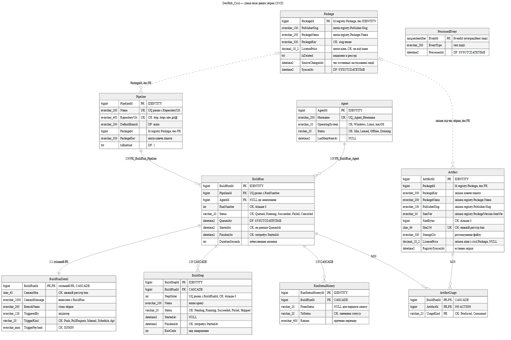

Проєкт №2, `DevHub_Registry`:

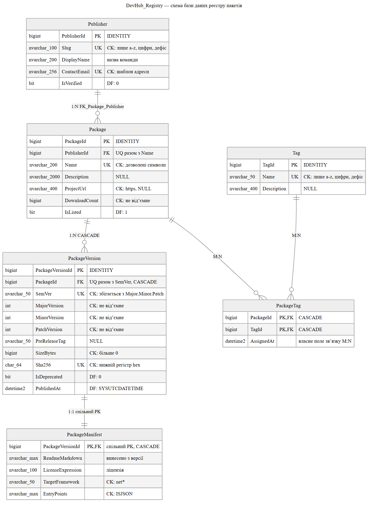

Проєкт №3: приклади документів кожної колекції в [docs/examples/](docs/examples).

## Розгортання

Потрібні SQL Server (наприклад, `(localdb)\MSSQLLocalDB`) із `sqlcmd` і Docker для MongoDB.
Усі скрипти ідемпотентні: перед кожною вставкою вони перевіряють, що запису ще немає, тож
повторний запуск не створює дублікатів і не видаляє даних.

### Проєкт №1 – `DevHub_Cicd`

```bash
sqlcmd -S "(localdb)\MSSQLLocalDB" -b -i db/p1/schema.sql
sqlcmd -S "(localdb)\MSSQLLocalDB" -b -i db/p1/procedures.sql
sqlcmd -S "(localdb)\MSSQLLocalDB" -b -i db/p1/seed.sql
sqlcmd -S "(localdb)\MSSQLLocalDB" -b -i db/p1/security.sql -v CicdAppPassword="Repetovskyi#Cicd26"
sqlcmd -S "(localdb)\MSSQLLocalDB" -b -i db/p1/verify.sql
```

`schema.sql` створює базу, таблиці, індекси й представлення; `procedures.sql` – шість
збережуваних процедур; `seed.sql` – тестові дані; `security.sql` – окремий логін застосунку
`devhub_cicd_app` з доступом лише до `DevHub_Cicd` і схеми `cicd`, а також роль читача без права
запису; `verify.sql` перевіряє ключі, обмеження, індекси, процедури й доступи та завершується
помилкою, якщо не пройшла хоч одна перевірка. Пароль логіна передають під час розгортання
через `-v`. Пароль у команді навчальний і призначений для локальної бази, але відповідає політиці
паролів Windows, тож SQL Server приймає його без змін.

Запуск процедур:

```sql
DECLARE @PipelineId BIGINT = (SELECT PipelineId FROM cicd.Pipeline WHERE Name = N'devhub-auth CI');
DECLARE @RunId BIGINT, @AgentId BIGINT;
EXEC cicd.usp_QueueBuildRun @PipelineId = @PipelineId, @CommitSha = '9e8d7c6b5a4f3e2d1c0b9a8f7e6d5c4b3a2f1e0d',
     @CommitMessage = N'Fix', @BranchName = N'main', @TriggeredBy = N'dev', @TriggerKind = 'Manual',
     @BuildRunId = @RunId OUTPUT;
EXEC cicd.usp_LeaseAgent @BuildRunId = @RunId, @OperatingSystem = N'Windows', @LeasedBy = N'dev', @AgentId = @AgentId OUTPUT;
EXEC cicd.usp_TransitionRunStatus @BuildRunId = @RunId, @ToStatus = 'Succeeded', @ChangedBy = N'dev';
EXEC cicd.usp_GetRunTimeline @BuildRunId = @RunId;
```

| Процедура | Операція |
| --- | --- |
| `usp_QueueBuildRun` | створення запуску, деталей і першого запису історії в одній транзакції |
| `usp_GetRunTimeline` | читання запуску з кроками, історією статусів і артефактами |
| `usp_TransitionRunStatus` | зміна статусу в явній транзакції; недопустимий перехід – помилка 50022 |
| `usp_DeleteBuildRun` | м’яке видалення завершеного запуску |
| `usp_LeaseAgent` | захоплення вільного агента і старт запуску |
| `usp_CompleteBuildRun` | завершення запуску: кроки, артефакти, історія й звільнення агента атомарно |

### Проєкт №2 – `DevHub_Registry`

```bash
sqlcmd -S "(localdb)\MSSQLLocalDB" -b -i db/p2/schema.sql
sqlcmd -S "(localdb)\MSSQLLocalDB" -b -i db/p2/seed.sql
sqlcmd -S "(localdb)\MSSQLLocalDB" -b -i db/p2/security.sql -v RegistryAppPassword="Kostenuk#Registry26"
sqlcmd -S "(localdb)\MSSQLLocalDB" -b -i db/p2/verify.sql
```

`security.sql` створює окремий логін застосунку `devhub_registry_app` з доступом лише до
`DevHub_Registry` і роль читача без права запису.

Схема готова до міграцій. Кожне обмеження й індекс має явне ім’я (`PK_`, `FK_`, `UQ_`, `CK_`,
`DF_`, `IX_`), тож наступна міграція змінює чи видаляє його за іменем однаково в будь-якому
середовищі, а `schema.sql` створює лише відсутні об’єкти. Далі структурою цієї бази керують
міграції EF Core Code First.

### Проєкт №3 – `devhub_telemetry`

```bash
docker run -d --name devhub-mongo -p 27017:27017 mongo:8
docker cp db/p3 devhub-mongo:/p3
docker exec devhub-mongo mongosh devhub_telemetry --quiet /p3/collections.js
docker exec devhub-mongo mongosh devhub_telemetry --quiet /p3/seed.js
docker exec devhub-mongo mongosh devhub_telemetry --quiet /p3/verify.js
```

`collections.js` створює колекції з валідацією JSON Schema та індекси. `seed.js` додає документи
й перед вставкою перевіряє наявність кожного за природним ключем. `verify.js` перевіряє
структуру, валідацію, індекси та запити.

### Перевірка індексів і обмежень вручну

```sql
SELECT t.name AS TableName, i.name AS IndexName, ep.value AS ServesQuery
FROM sys.indexes AS i
JOIN sys.tables AS t ON t.object_id = i.object_id
LEFT JOIN sys.extended_properties AS ep ON ep.major_id = i.object_id AND ep.minor_id = i.index_id AND ep.class = 7
WHERE i.name LIKE 'IX[_]%';

SELECT * FROM sys.foreign_keys;
```

## Сервіс збірок CI/CD

Проєкт №1 реалізовано як окремий мікросервіс із трьома шарами. Залежності спрямовані в один бік:
контролери звертаються лише до сервісів, сервіси – до Unit of Work і репозиторіїв, а моделі та
доменні винятки лежать у `Cicd.Domain`, який бачать і DAL, і BLL. Це означає, що жоден SQL-запит
не виходить за межі DAL. Контролери рішень не приймають.

### Схема рішення

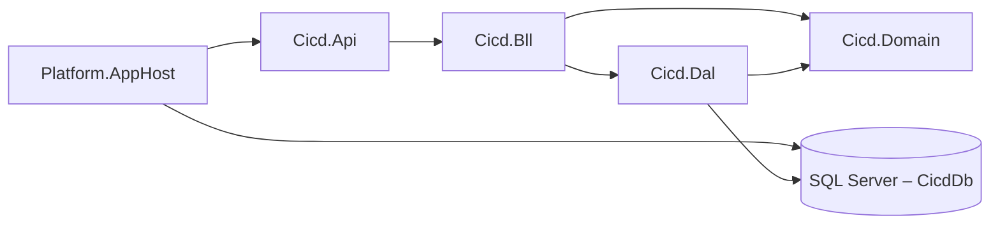

| Проєкт | Вміст |
| --- | --- |
| `Cicd.Api` | контролери, глобальний обробник помилок у форматі ProblemDetails, `Program.cs`, `appsettings.json` |
| `Cicd.Bll` | DTO, профілі AutoMapper, сервіси й бізнес-правила |
| `Cicd.Dal` | `IGenericRepository<T>`, `BaseDapperRepository<T>`, репозиторії на Dapper і на чистому ADO.NET, Unit of Work |
| `Cicd.Domain` | моделі таблиць схеми `cicd` і доменні винятки |
| `Cicd.Tests` | інтеграційні тести DAL і BLL, перевірка конфігурації AutoMapper |
| `Platform.AppHost` | запуск API разом з усією платформою в .NET Aspire |

### Що потрібно для запуску

Потрібні .NET SDK 9.0.318 (версію зафіксовано в `global.json`) і Docker Desktop; Visual Studio 2022
17.14 відкриває `Platform.slnx`, але для запуску достатньо командного рядка. Перший запуск
завантажує образ SQL Server 2022, це близько 2,3 ГБ, тому він триває кілька хвилин; наступні
стартують приблизно за пів хвилини.

API й Aspire Dashboard працюють через HTTPS із сертифікатом розробника .NET. Один раз на машині
його треба зробити довіреним, інакше `curl` і браузер відхилять з’єднання:

```bash
dotnet dev-certs https --trust
```

Ключ ліцензії AutoMapper (безкоштовна редакція Community з automapper.io) зберігається в user
secrets проєкту `Cicd.Api`, а не в репозиторії. Без ключа сервіс працює так само, AutoMapper лише
записує в лог попередження про відсутню ліцензію.

```bash
dotnet user-secrets set "AutoMapper:LicenseKey" "<ключ з automapper.io>" --project Services/Cicd/Cicd.Api
```

### Запуск через Aspire

Сервіс стартує разом з усією платформою, кроки наведено в розділі «Запуск платформи». AppHost
створює контейнер SQL Server, у ньому базу `DevHub_Cicd` як ресурс `CicdDb` і заповнює її скриптами
`db/p1/schema.sql`, `procedures.sql` та `seed.sql`; API стартує лише тоді, коли база готова. Через
Gateway сервіс доступний на `http://localhost:5000`, напряму – на `https://localhost:7178`, опис
усіх ендпоінтів – на `https://localhost:7178/swagger`.

Перелік ендпоінтів API у Swagger:

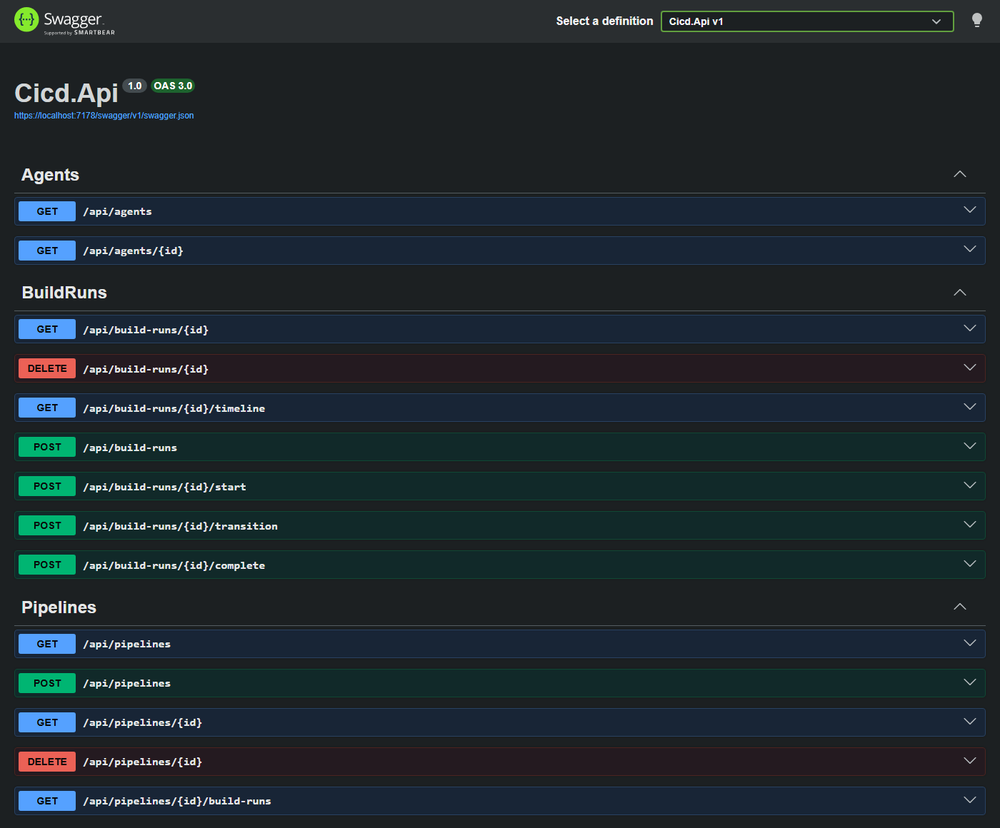

Рядок підключення `ConnectionStrings:CicdDb` API читає з `appsettings.json`; за замовчуванням він
вказує на базу в LocalDB, розгорнуту за розділом «Розгортання». Aspire передає API рядок підключення до контейнера
через змінну оточення `ConnectionStrings__CicdDb`, яка має пріоритет над файлом; так само можна
вказати будь-яку іншу базу без зміни коду. Без Aspire API запускається командою
`dotnet run --project Services/Cicd/Cicd.Api` і працює з LocalDB.

### Транзакції, рівень ізоляції й таймаути

Unit of Work відкриває одне з’єднання на HTTP-запит, і всі репозиторії працюють через нього та
через одну поточну транзакцію. Найважливіша операція – завершення запуску
(`POST /api/build-runs/{id}/complete`), що в одній транзакції переводить запуск у `Succeeded`
процедурою `usp_TransitionRunStatus`, додає артефакти, зв’язує їх із запуском і копіює з локальної
копії пакета `cicd.Package` його Id, ключ, назву й ціну ліцензії як знімок за політикою дублювання, тож
артефакт не залежить від того, що згодом станеться з пакетом у Реєстрі. Збій будь-якого кроку відкочує транзакцію повністю. Статус
запуску тоді лишається `Running`.

Рівень ізоляції – `READ COMMITTED`. Процедури самі блокують рядок, який змінюють
(`UPDLOCK, HOLDLOCK`), тому `REPEATABLE READ` чи `SERIALIZABLE` лише довше тримали б зайві
блокування й підвищували ризик взаємних блокувань, а узгодженості не додали б. Паралельні зміни
того самого запуску ловить `RowVersion`. Застаріла версія рядка дає 409. Таймаут команди – 30 с
(`RepositoryBase.CommandTimeoutSeconds`), таймаут з’єднання – стандартні 15 с SqlClient.

### Помилки

Усі помилки повертаються у форматі ProblemDetails з полем `traceId`; перетворення робить один
глобальний обробник `DomainExceptionHandler`.

| Ситуація | Статус |
| --- | --- |
| `NotFoundException` – запису немає | 404 |
| `BusinessConflictException` – недопустимий перехід статусу, дублікат, вимкнений конвеєр | 409 |
| `ValidationException` і порушені атрибути DataAnnotations на DTO | 400 |
| будь-яка інша помилка | 500 |

### Приклади запитів (curl)

У свіжому контейнері `seed.sql` створює чотири запуски, тому перший новий запуск отримує Id 5.

```bash
API=https://localhost:7178

curl -i $API/api/pipelines

curl -i -X POST $API/api/build-runs -H "Content-Type: application/json" \
  -d '{"pipelineId":1,"commitSha":"a1b2c3d4e5f60718293a4b5c6d7e8f9012345678","commitMessage":"Fix token refresh","branchName":"main","triggeredBy":"o.kovalenko","triggerKind":"Manual"}'

curl -i -X POST $API/api/build-runs/5/start -H "Content-Type: application/json" \
  -d '{"operatingSystem":"Windows","leasedBy":"o.kovalenko"}'

curl -i -X POST $API/api/build-runs/5/complete -H "Content-Type: application/json" \
  -d '{"completedBy":"o.kovalenko","artifacts":[{"semVer":"2.2.0","sizeBytes":1130496,"sha256":"5f1e2d3c4b5a69788796a5b4c3d2e1f00f1e2d3c4b5a69788796a5b4c3d2e1f0","storageUri":"https://artifacts.devhub.local/auth/2.2.0.nupkg"}]}'

curl -i $API/api/build-runs/5/timeline

curl -i -X POST $API/api/build-runs/5/complete -H "Content-Type: application/json" \
  -d '{"completedBy":"o.kovalenko","artifacts":[{"semVer":"2.2.1","sizeBytes":1,"sha256":"6e2f3d4c5b6a79808a97b6c5d4e3f2011f2e3d4c5b6a79808a97b6c5d4e3f201","storageUri":"https://artifacts.devhub.local/auth/2.2.1.nupkg"}]}'

curl -i $API/api/build-runs/999999

curl -i "$API/api/agents?status=Idle"
```

Перший `POST` повертає 201 із заголовком `Location`, `start` захоплює вільного агента, перше
`complete` – 200 із хронологією запуску та новим артефактом. Повторне `complete` того самого
запуску дає 409. Запит на Id, якого немає, дає 404, а не 500.

## Сервіс реєстру пакетів

Проєкт №2 реалізовано як другий мікросервіс із тими самими трьома шарами, але доступ до даних
побудовано на Entity Framework Core. Схему бази описують сутності з `Registry.Domain` і конфігурації
Fluent API з `Registry.Dal/Configurations`, по одному класу на сутність; базу створює міграція.
Назви таблиць, ключів, обмежень та індексів у міграції ті самі, що й у `db/p2/schema.sql`.

| Проєкт | Вміст |
| --- | --- |
| `Registry.Api` | контролери, глобальний обробник помилок, `Program.cs`, `appsettings.json`, `Dockerfile` |
| `Registry.Bll` | DTO, профілі AutoMapper, валідатори FluentValidation, специфікації, сервіси |
| `Registry.Dal` | `RegistryDbContext`, конфігурації, міграції, репозиторії, Unit of Work, початкові дані |
| `Registry.Domain` | сутності й доменні винятки |

Таблиця `Package` отримала стовпець `LicensePrice` типу `decimal(18,2)` – ціну одного місця
комерційної ліцензії. Нуль означає безкоштовний пакет. Стовпець додано і в `db/p2/schema.sql`.

### Запуск і застосування міграцій

Потрібні .NET SDK 9.0.318, SQL Server LocalDB та інструмент `dotnet-ef`
(`dotnet tool install --global dotnet-ef`).

1. Переконайтеся, що бази `DevHub_Registry` на сервері ще немає. Якщо її вже створено скриптами з
   розділу «Розгортання», видаліть її або вкажіть іншу назву бази у змінній оточення
   `ConnectionStrings__RegistryDb`: міграція створює таблиці з нуля й на готовій схемі зупиниться
   з помилкою.
2. Застосуйте міграції:

   ```bash
   dotnet ef database update --project Services/Registry/Registry.Dal --startup-project Services/Registry/Registry.Api
   ```

3. Запустіть API:

   ```bash
   dotnet run --project Services/Registry/Registry.Api --launch-profile https
   ```

4. Відкрийте `https://localhost:7179/swagger`.

Крок 2 можна пропустити: під час старту API сам викликає `MigrateAsync()` і застосовує міграції,
яких бракує. SQL-скрипт початкової міграції, згенерований командою `dotnet ef migrations script`,
лежить у `Services/Registry/Registry.Dal/Migrations/InitialCreate.sql`. Нову міграцію додає команда:

```bash
dotnet ef migrations add <Назва> --project Services/Registry/Registry.Dal --startup-project Services/Registry/Registry.Api
```

### Початкові дані

Довідники – три видавці й п’ять тегів – мають фіксовані Id і записані в міграцію через `HasData`.
Пакети, версії, маніфести та зв’язки з тегами додає `DbInitializer` після міграцій, якщо таблиця
пакетів порожня, тому повторний запуск нічого не дублює. У середовищі Production `DbInitializer`
не викликається. Перші чотири пакети отримують ті самі Id, що й у `db/p2/seed.sql`, бо на них
посилаються інші контексти.

### Пагінація, фільтрація й сортування

`GET /api/packages` приймає параметри `page` (з 1), `pageSize` (типово 20, не більше 100), `search`,
`publisherId`, `minPrice`, `maxPrice`, `sortBy` (`name`, `price` або `downloads`) і `sortDir`
(`asc` або `desc`). Метадані сторінки повертаються в тілі відповіді поруч з елементами: `items`,
`totalCount`, `page`, `pageSize`, `totalPages`, `hasNext`, `hasPrevious`. Фільтр, сортування, `Skip`
і `Take` описує специфікація `PackagesFilterSpec`, репозиторій застосовує її до `DbSet`, тож база
повертає лише одну сторінку. Значення `totalCount` рахує окремий запит `COUNT` із тим самим
фільтром.

```bash
API=https://localhost:7179

curl -i "$API/api/packages?page=2&pageSize=5&sortBy=price&sortDir=desc"

curl -i "$API/api/packages?search=devhub&minPrice=0&maxPrice=50"

curl -i $API/api/packages/2

curl -i -X POST $API/api/packages -H "Content-Type: application/json" \
  -d '{"publisherId":1,"name":"devhub-cache","description":"Two-level cache helpers.","licensePrice":15.50}'

curl -i -X POST $API/api/packages -H "Content-Type: application/json" \
  -d '{"publisherId":1,"name":"devhub-cache","licensePrice":0}'

curl -i $API/api/packages/999999

curl -i "$API/api/tags/infrastructure/recent-packages?since=2026-08-01"
```

Перший `POST` повертає 201 із заголовком `Location`, другий із тією самою назвою – 409. Запит на Id,
якого немає, дає 404 у форматі ProblemDetails.

### Валідація й помилки

Прості правила (обов’язковість, довжина, діапазон) задано атрибутами DataAnnotations на DTO,
складніші – валідаторами FluentValidation: дозволені символи назви, адреса лише з `https://`, ціна
з двома знаками після коми, список полів сортування. Валідатори зареєстровано через
`AddValidatorsFromAssembly`, контролер викликає їх явно й повертає `ValidationProblemDetails`. Решту
помилок перетворює один обробник `GlobalExceptionHandler`. Поле `detail` заповнюється лише в
середовищі Development.

| Ситуація | Статус |
| --- | --- |
| `EntityNotFoundException` – пакета, тега чи видавця немає | 404 |
| `ValidationException`, порушені атрибути або правила валідатора | 400 |
| `ConflictException` – пакет із такою назвою у видавця вже є, тег уже призначено | 409 |
| `DomainException` – порушено правило сутності, наприклад завантаження прихованого пакета | 409 |
| будь-яка інша помилка | 500 |

### Логування

Serilog налаштовано один раз у `Platform.ServiceDefaults` (розділ «Логування й трасування»), тому
сервіс пише ті самі структуровані записи, що й решта платформи, з `CorrelationId` запиту. Секція
`Serilog` в `appsettings.Development.json` лишає для категорії
`Microsoft.EntityFrameworkCore.Database.Command` рівень Information, тож у лозі видно кожен
SQL-запит EF Core. Виняток записується один раз, в обробнику помилок. Рівень можна змінити без
правки файла змінною оточення, наприклад
`Serilog__MinimumLevel__Override__Microsoft.EntityFrameworkCore.Database.Command=Warning`.

Запит `GET /api/packages/2` завантажує пакет разом із видавцем, версіями, маніфестами й тегами через
`Include` – це один SQL-запит. Запит `GET /api/tags/3` спершу читає тег, а пакети довантажує окремо
через `Entry(...).Collection(...).LoadAsync()` – це два запити. У вкладці Structured logs фільтр за
`CorrelationId` першого запиту показує один запис `Executed DbCommand`, другого – два.

### Знімки екрана

Перелік ендпоінтів API у Swagger:

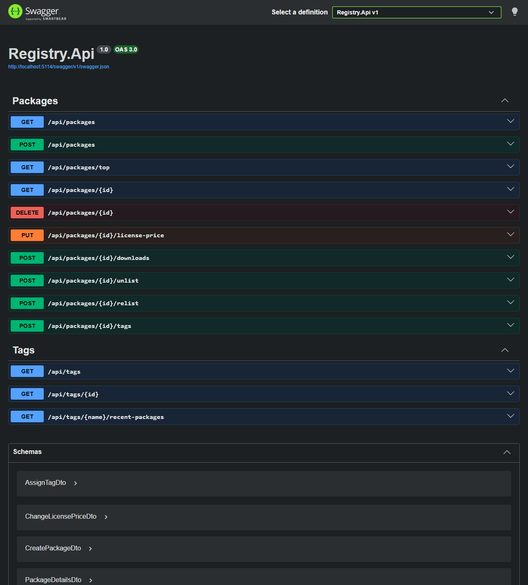

Відповідь із пагінацією на запит `page=2&pageSize=5`:

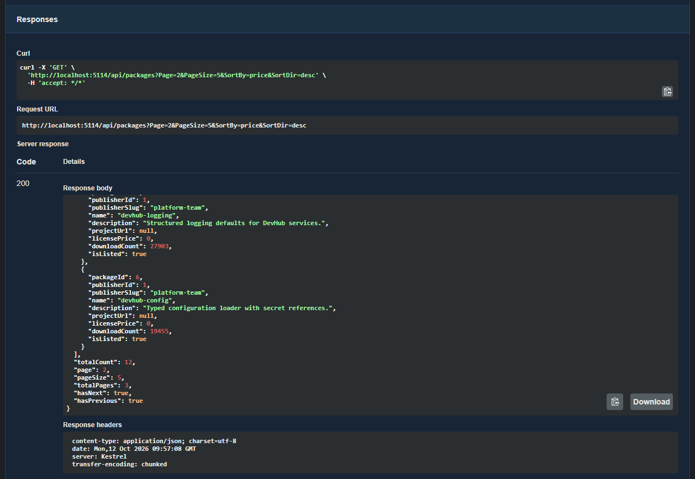

Відповідь 400 з помилками валідації по полях:

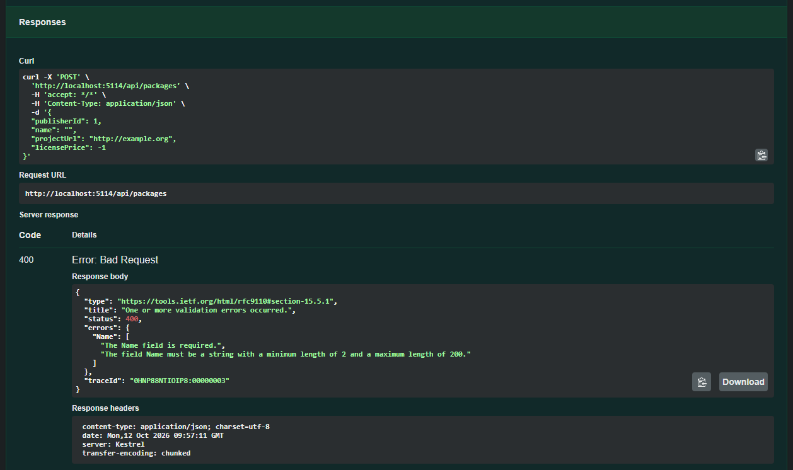

## Сервіс телеметрії та обговорень

Проєкт №3 побудовано за Clean Architecture з чотирьох шарів, і залежності в ньому спрямовані
всередину. `Telemetry.Domain` не посилається на жоден проєкт, а з пакетів має лише `MongoDB.Bson`
заради типу `ObjectId`; драйвера MongoDB у домені немає. `Telemetry.Application` знає тільки домен.
`Telemetry.Infrastructure` реалізує інтерфейси, оголошені в домені й в Application. `Telemetry.WebApi`
посилається на Application та Infrastructure, причому Infrastructure потрібен йому лише для
реєстрації залежностей під час старту. Кожна операція API – окрема команда або запит MediatR, і
кожен проходить через ланцюжок behaviors: логування, валідацію FluentValidation, вимірювання часу.

### Схема шарів

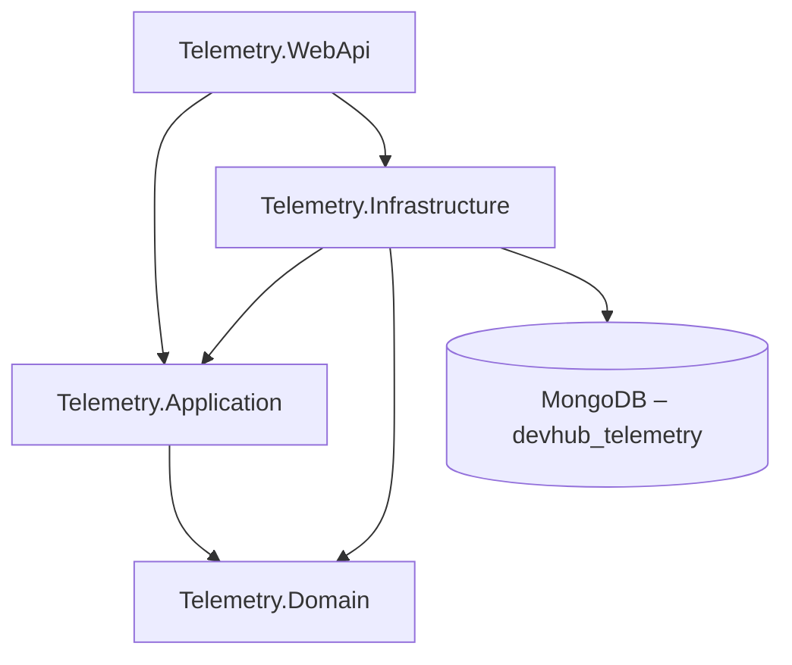

| Проєкт | Вміст |
| --- | --- |
| `Telemetry.Domain` | `BaseEntity`, `ValueObject`, сутності `Discussion`, `Comment`, `CrashReport`, value objects `ExceptionInfo`, `StackFrame`, `PerformanceMetric`, доменні винятки, інтерфейси репозиторіїв |
| `Telemetry.Application` | команди й запити з обробниками та валідаторами, behaviors, інтерфейси читання `IDiscussionQueries` і `ICrashReportQueries`, профіль AutoMapper, `DependencyInjection.cs` |
| `Telemetry.Infrastructure` | `MongoDbContext`, мапінг `BsonClassMap`, репозиторії, реалізації інтерфейсів читання, сідінг, створення індексів, `DependencyInjection.cs` |
| `Telemetry.WebApi` | контролери, глобальний обробник помилок, `Program.cs`, `appsettings*.json` |
| `Telemetry.Tests` | модульні тести домену, конвеєра валідації, мапінгу AutoMapper і BSON |

Сервіс працює з колекціями `discussions` і `crashReports`. Документи мають ту саму структуру, що
створюють скрипти `db/p3`: імена полів у camelCase, коментарі з відповідями вкладено в
обговорення, а підсумки винятку, кадри стека й метрику – у звіт про збій. Для оптимістичної
конкурентності валідатори обох колекцій у `db/p3/collections.js` отримали поля `updatedAt` і
`version`. Скрипт дописує `version: 0` документам, де цього поля ще немає. Оновлення записується
лише в документ з очікуваною версією.

### Запуск

Потрібні .NET SDK 9.0.318 і Docker Desktop.

1. Запустіть MongoDB 8 у контейнері (той самий, що в розділі «Розгортання»; якщо контейнер уже
   є, достатньо `docker start devhub-mongo`):

   ```bash
   docker run -d --name devhub-mongo -p 27017:27017 mongo:8
   ```

2. За бажанням розгорніть базу скриптами `db/p3` за розділом «Розгортання», тоді колекції матимуть
   валідатори JSON Schema. Без цього кроку сервіс сам створить колекції, індекси й початкові дані.
3. Збережіть ключ ліцензії Lucky Penny у user secrets. Один ключ покриває і MediatR, і AutoMapper;
   без нього сервіс працює так само, лише пише в лог попередження.

   ```bash
   dotnet user-secrets set "LuckyPenny:LicenseKey" "<ключ>" --project Services/Telemetry/Telemetry.WebApi
   ```

4. Запустіть API:

   ```bash
   dotnet run --project Services/Telemetry/Telemetry.WebApi --launch-profile https
   ```

5. Відкрийте `https://localhost:7180/swagger`.

Під час старту `IndexCreationService` створює складені, унікальний, текстовий і TTL-індекси з тими
самими назвами, що в `db/p3/collections.js`, тож сервіс і скрипт можна застосовувати до однієї бази.
Після нього кожен `IDataSeeder` перевіряє, чи порожня його колекція, і лише тоді одним
`InsertManyAsync` додає документи з `Telemetry.Infrastructure/Seeding/Data`. Повторний запуск
нічого не дублює. У середовищі Production сідінг не виконується.

Рядок підключення й назву бази задає секція `MongoDb` в `appsettings.json`; для Development, Staging
і Production є окремі файли `appsettings.{Environment}.json`. Розмір пулу з’єднань і таймаут вибору
сервера записано в самому рядку (`maxPoolSize`, `serverSelectionTimeoutMS`). Змінна оточення
`MongoDb__ConnectionString` має пріоритет над файлом. Під AppHost рядок підключення приходить як
`ConnectionStrings:TelemetryDb` і замінює значення із секції `MongoDb`. Стан підключення до MongoDB
показує перевірка `telemetry-db` у відповіді `GET /health/ready`.

### Приклади запитів (curl)

```bash
API=https://localhost:7180

curl -i "$API/api/discussions?state=open&page=1&pageSize=5"

curl -i -X POST $API/api/discussions -H "Content-Type: application/json" \
  -d '{"packageId":5,"packageKey":"platform-team/devhub-logging","packageName":"devhub-logging","publisherSlug":"platform-team","title":"Structured scopes are dropped by the console sink","category":"bug","openedBy":"o.kovalenko"}'

curl -i -X POST $API/api/discussions -H "Content-Type: application/json" \
  -d '{"packageId":0,"packageKey":"platform-team/devhub-logging","packageName":"devhub-logging","publisherSlug":"platform-team","title":"Structured scopes are dropped by the console sink","category":"bug","openedBy":"o.kovalenko"}'

curl -i -X PUT $API/api/discussions/<id> -H "Content-Type: application/json" \
  -d '{"title":"Structured scopes are dropped by the console sink","category":"bug","labels":["sink"],"version":0}'

curl -i "$API/api/crash-reports?severity=high"
```

Перший `POST` повертає 201 і заголовок `Location` з ObjectId у вигляді рядка. Якщо повторити його,
асинхронне правило валідатора знайде таку саму назву в пакета й поверне 400. Запит із
`packageId: 0` відхиляється ще до обробника: у лозі є рядок `Handling CreateDiscussionCommand` і
попередження про `ValidationException`, а рядка `Handled` немає. Перший `PUT` з `version: 0` повертає
обговорення з версією 1, той самий `PUT` удруге дає 409.

| Ситуація | Статус |
| --- | --- |
| `NotFoundException` – документа немає | 404 |
| `ValidationException` FluentValidation, зокрема некоректний ObjectId | 400 |
| `DomainException` – порушено правило сутності, наприклад коментар у закритому обговоренні | 400 |
| `ConflictException` – документ уже змінено, версія застаріла | 409 |
| `MongoWriteException` з DuplicateKey – порушено унікальний індекс | 409 |
| інша помилка запису MongoDB, наприклад відмова валідатора колекції | 400 |
| `MongoConnectionException` або таймаут вибору сервера | 503 |
| будь-яка інша помилка | 500 |

### Знімки екрана

Перелік ендпоінтів API у Swagger:

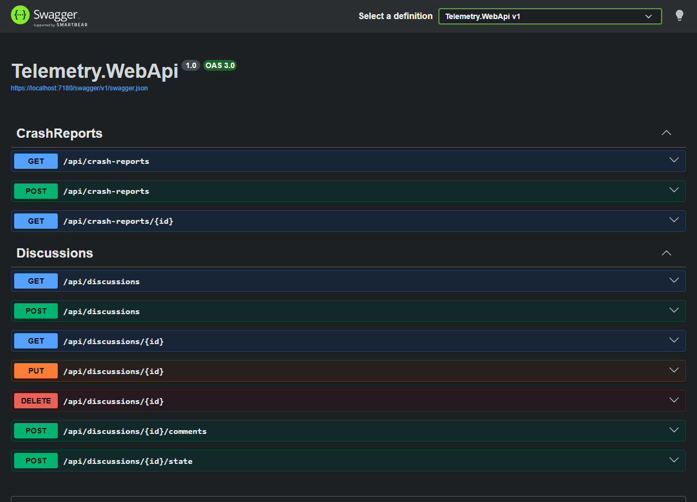

Документ `discussions` у MongoDB Compass, записаний сідінгом сервісу: поля в camelCase, вкладені
коментарі з відповідями й реакціями, поле `version`, без службових полів .NET:

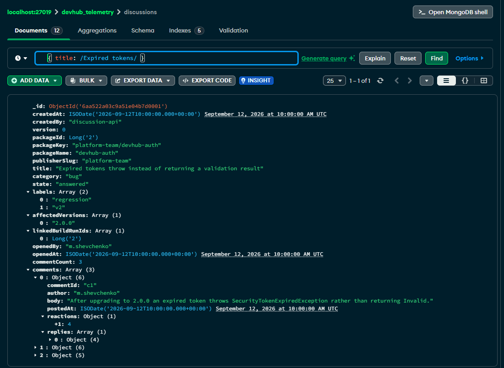

Результат `db.discussions.getIndexes()` у вбудованій оболонці Compass:

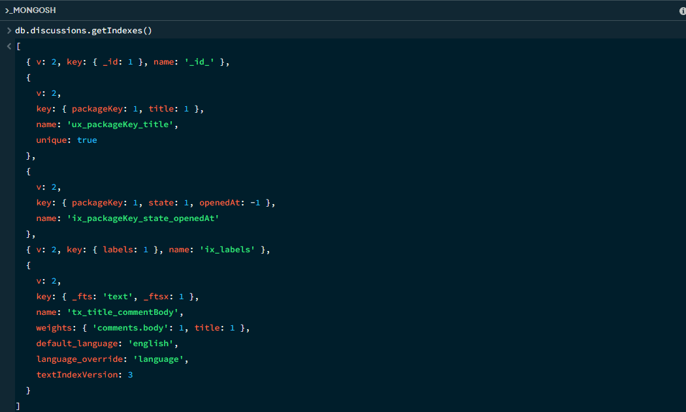

## Платформа на .NET Aspire

Три сервіси працюють як одна платформа, яку запускає одна команда. `Platform.AppHost` піднімає
контейнери баз даних, сервіси, агрегатор і шлюз у правильному порядку. Клієнт звертається лише до
`Platform.ApiGateway` на порту 5000, а сервіси знаходять один одного за іменами ресурсів AppHost
(`cicd-api`, `registry-api`, `telemetry-api`, `aggregator`) замість `localhost` і порту.

### Схема рішення

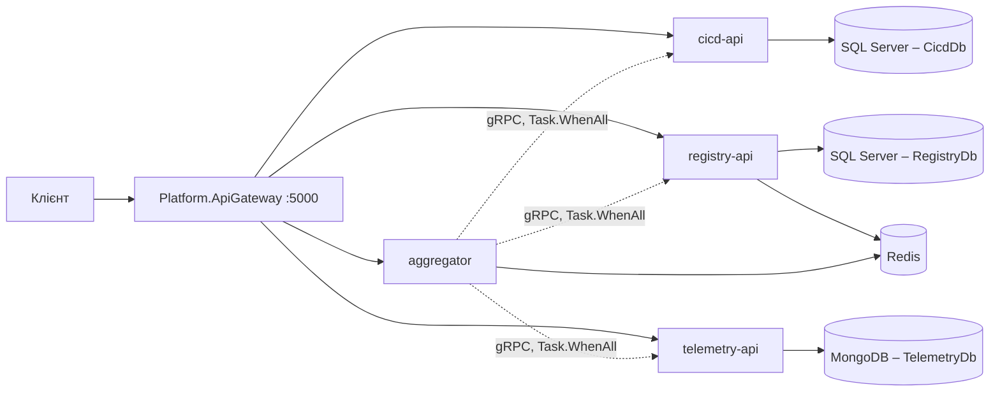

| Проєкт | Вміст |
| --- | --- |
| `Platform.AppHost` | `AppHost.cs`: контейнери SQL Server, MongoDB і Redis з томами даних, реєстрація сервісів, агрегатора й шлюзу з `WithReference` і `WaitFor` |
| `Platform.ServiceDefaults` | `Extensions.cs` (Serilog, OpenTelemetry, health checks, service discovery, стійкість HttpClient, метр `Registry.Cache`), `CorrelationIdMiddleware`, `CorrelationIdHandler`, `GrpcLoggingInterceptor` |
| `Platform.ApiGateway` | маршрути YARP, логування маршрутизації, `Dockerfile` |
| `Platform.Aggregator` | типізовані gRPC-клієнти трьох сервісів, кеш картки в Redis, політики стійкості, картка запуску збірки, обробка часткових відмов |

Кожен сервіс посилається лише на `Platform.ServiceDefaults`, а AppHost – на всі сервіси, шлюз і
агрегатор. На AppHost не посилається ніхто. У коді сервісів змінено тільки `Program.cs`: він на
початку викликає `AddServiceDefaults()`, після `Build()` підключає `CorrelationIdMiddleware`, а
наприкінці `MapDefaultEndpoints()`; власне налаштування Serilog із сервісів прибрано. Поза
`Program.cs` лежать ще дві зміни: власні spans бізнес-операцій (розділ «Логування й трасування») і
підписка драйвера MongoDB на трасування в `MongoDbContext`.

### Запуск платформи

Потрібні .NET SDK 9.0.318 і Docker Desktop.

1. Запустіть Docker Desktop.
2. Один раз зробіть довіреним сертифікат розробника: `dotnet dev-certs https --trust`.
3. Збережіть пароль SQL Server у user secrets AppHost. Пароль – параметр-секрет `sql-password`, у коді
   його немає. Нижче локальний навчальний пароль:

   ```bash
   dotnet user-secrets set "Parameters:sql-password" "Repetovskyi#Sql26" --project Platform.AppHost
   ```

4. За потреби збережіть ключі ліцензій AutoMapper і Lucky Penny (розділи сервісів вище). Секрети
   автентифікації (`jwt-secret`, паролі баз і клієнтів) перелічено в розділі «Автентифікація та
   авторизація», підрозділ «Секрети й запуск».
5. З кореня репозиторію запустіть AppHost:

   ```bash
   dotnet run --project Platform.AppHost
   ```

6. Відкрийте Aspire Dashboard за посиланням із консолі й дочекайтеся статусу Running для всіх
   ресурсів.
7. Надсилайте запити на Gateway: `http://localhost:5000`.

Перший запуск завантажує образи SQL Server 2022, MongoDB 8 і Redis. Дані лежать у томах Docker, тому
після перезапуску бази лишаються. Том SQL Server запам’ятовує пароль першого запуску; щоб змінити
пароль, видаліть том `platform.apphost-…-sql-data`. Порядок старту задають ланцюжки `WaitFor`:
бази даних, потім сервіси, агрегатор і наостанок Gateway. Сервіси отримують рядки підключення
`ConnectionStrings__CicdDb`, `ConnectionStrings__RegistryDb` і `ConnectionStrings__TelemetryDb`;
імена збігаються з тими, що сервіси читали й раніше, а резервні рядки в `appsettings.json` лишилися
для запуску без Aspire.

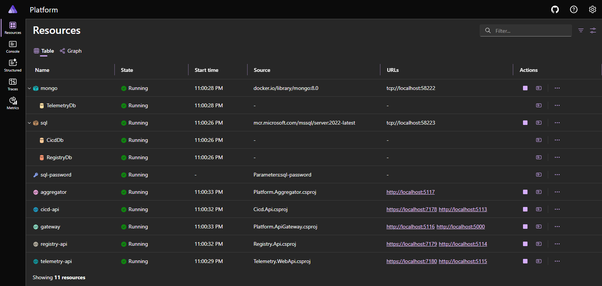

### Маршрути Gateway

Маршрути YARP лежать у секції `ReverseProxy` файла `Platform.ApiGateway/appsettings.json`. Кожен
префікс API має маршрут виду `/api/pipelines/{**catch-all}`, а кластер сервісу вказує на адресу
`http://<ім’я ресурсу>`, яку підставляє service discovery Aspire. Маршрут агрегатора має `Order: 1`.

| Префікс | Кластер | Ресурс |
| --- | --- | --- |
| `/api/aggregator` | `aggregator` | `aggregator` |
| `/api/pipelines`, `/api/build-runs`, `/api/agents` | `cicd` | `cicd-api` |
| `/api/packages`, `/api/tags` | `registry` | `registry-api` |
| `/api/discussions`, `/api/crash-reports` | `telemetry` | `telemetry-api` |
| `/auth`, `/users` | `auth` | `auth-api` |
| `/api/secrets` | `secrets` | `secrets-api` |

`CorrelationIdMiddleware` стоїть перед `MapReverseProxy`. Якщо клієнт не надіслав заголовок
`X-Correlation-Id`, Gateway генерує GUID і записує факт генерації в лог. Ідентифікатор потрапляє в
проксований запит і повертається в заголовку відповіді. Після кожного запиту Gateway логує метод,
шлях, IP клієнта, маршрут, кластер, адресу сервісу, статус і тривалість; помилку недоступного
сервісу пише окремим попередженням.

### Приклади запитів через Gateway (curl)

```bash
GW=http://localhost:5000
TOKEN=$(curl -s -X POST $GW/auth/login -H "Content-Type: application/json" \
  -d '{"userName":"kostenuk.admin","password":"Kostenuk#Admin26"}' | sed -E 's/.*"accessToken":"([^"]+)".*/\1/')
AUTH="Authorization: Bearer $TOKEN"

curl -i -H "$AUTH" $GW/api/pipelines

curl -i -H "$AUTH" "$GW/api/packages?page=1&pageSize=5"

curl -i -H "$AUTH" "$GW/api/discussions?packageKey=platform-team/devhub-auth"

curl -i -X PUT -H "$AUTH" $GW/api/packages/4/license-price -H "Content-Type: application/json" \
  -d '{"licensePrice":12.50}'

curl -i -H "$AUTH" -H "X-Correlation-Id: repetovskyi-card-run1" $GW/api/aggregator/build-runs/1/full

curl -i -H "$AUTH" $GW/api/aggregator/build-runs/999/full
```

Кожна відповідь має заголовок `X-Correlation-Id`; ідентифікатор, який надіслав клієнт, Gateway не
змінює. `PUT` повертає 204. Картка запуску 1 повертає 200, картка запуску, якого немає, – 404. Без
заголовка `Authorization` Gateway відповідає 401; токен і права описано в розділі «Автентифікація та
авторизація», там само є секрети, без яких платформа не стартує. Приклади в наступних розділах
передають той самий `$AUTH`.

### Aggregator

`GET /api/aggregator/build-runs/{id}/full` повертає картку запуску збірки. Спершу агрегатор читає
хронологію запуску з `cicd-api`, бо без неї складати нічого. Далі паралельно через `Task.WhenAll`
запитує дані всіх пакетів запуску з `registry-api` одним викликом, а обговорення й звіти про збої
кожного пакета – з `telemetry-api`. Кожен виклик пише в лог свою тривалість, а `CancellationToken`
доходить до всіх викликів. До картки потрапляють лише пакети з артефактів цього запуску та обговорення
саме цих пакетів.

Сервіси агрегатор викликає через gRPC (розділ «gRPC і кешування» нижче). `CorrelationIdHandler` із
`Platform.ServiceDefaults` додає до кожного вихідного виклику той самий `X-Correlation-Id`.

```json
{
  "run": { "buildRunId": 1, "pipelineName": "devhub-auth CI", "runNumber": 1, "status": "Succeeded", "durationSeconds": 420 },
  "packages": [
    {
      "packageId": 2,
      "packageKey": "platform-team/devhub-auth",
      "builtVersions": ["2.0.0"],
      "licensePrice": 0.00,
      "downloadCount": 48210,
      "discussionCount": 2,
      "discussions": [ { "title": "Document the claim mapping for service accounts", "state": "open" } ],
      "crashReportCount": 1,
      "crashReports": [ { "kind": "unhandledException", "severity": "high" } ]
    }
  ],
  "warnings": []
}
```

JSON іде в camelCase, а поля зі значенням null агрегатор не серіалізує. Якщо `telemetry-api`
недоступний, агрегатор усе одно повертає картку зі статусом 200: дані запуску й пакетів є, полів
обговорень і збоїв немає, а `warnings` містить `"telemetry-api is unavailable"`. Перевірити це можна
так:

1. У Dashboard зупиніть ресурс `telemetry-api` (дія Stop).
2. Повторіть запит картки запуску 1.
3. Запустіть ресурс знову (Start) – наступна відповідь знову повна.

Політики стійкості клієнтів агрегатора описує розділ «Політики стійкості клієнтів Aggregator» на
початку README. Поки `telemetry-api` зупинено, перша картка приходить приблизно за 2 секунди, а після
кількох невдалих викликів circuit breaker відхиляє їх одразу, і картка повертається за десятки
мілісекунд. Недоступність `cicd-api` дає 503, бо без запуску картки не існує.

### Логування й трасування

`AddServiceDefaults()` робить Serilog основним логером для всіх п’яти застосунків. До кожного запису
Serilog додає властивості `ServiceName`, `EnvironmentName`, `MachineName`, `ThreadId` і контекст запиту
(`FromLogContext`); у консоль вони йдуть у форматі `CompactJsonFormatter`. Мінімальний рівень –
Debug у Development та Information в інших середовищах, а шумні категорії ASP.NET Core, EF Core,
HttpClient і Polly підняті до Warning. Параметр `writeToProviders: true` передає записи провайдеру
OpenTelemetry, тому вони з’являються у вкладці Structured logs разом із `TraceId` і `SpanId`.

`CorrelationIdMiddleware` кладе `CorrelationId` у `LogContext` і логує початок та кінець запиту.
Ідентифікатор кореляції створює застосунок, і він описує звернення клієнта; `TraceId` генерує
OpenTelemetry для технічного трасування. Пошук за одним `CorrelationId` у Structured logs знаходить
записи всіх сервісів ланцюжка:

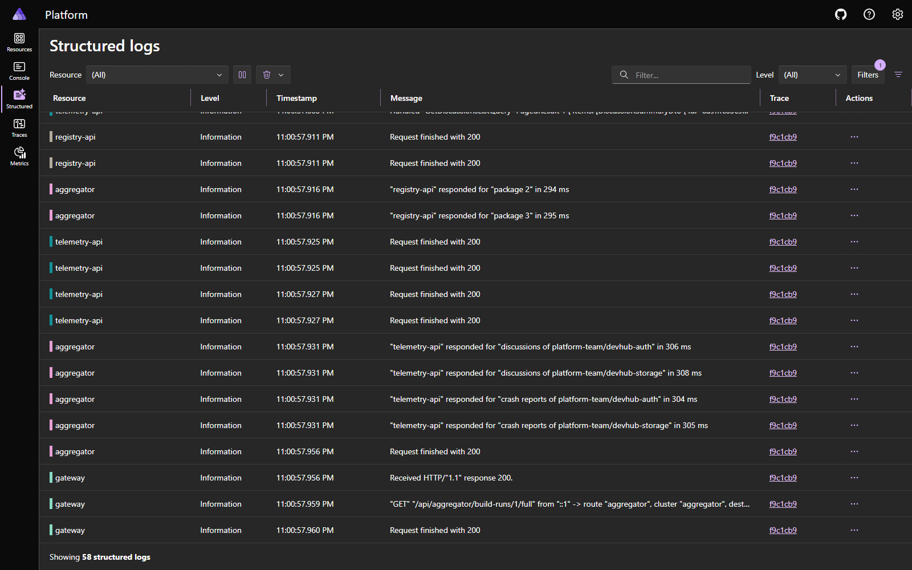

Трасування охоплює вхідні запити ASP.NET Core, вихідні виклики HttpClient, команди SqlClient (і
Dapper, і EF Core працюють через `Microsoft.Data.SqlClient`) та команди MongoDB через
`DiagnosticsActivityEventSubscriber`. Експорт іде через OTLP у Dashboard. У Development
зберігається кожен trace, в інших середовищах частку задає `OpenTelemetry:SamplingRatio`. Власні
spans мають бізнес-операції: `QueueBuildRun` і `CompleteBuildRun` у `BuildRunService`,
`CreatePackage`, `ChangeLicensePrice` і `UnlistPackage` у `PackageService`, `CreateDiscussion` і
`ChangeDiscussionState` в обробниках команд Telemetry. Trace картки запуску показує весь шлях
Gateway → Aggregator → сервіси → бази даних, і виклики `registry-api` та `telemetry-api` в ньому
йдуть паралельно:

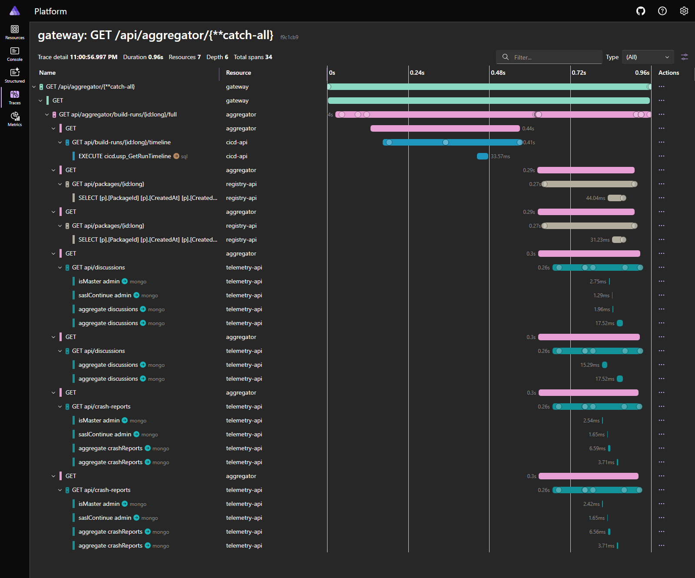

## gRPC і кешування

Реєстр пакетів читають значно частіше, ніж змінюють. Картку пакета запитує кожна картка запуску
збірки, а змінюють її кілька операцій мейнтейнера. Тому дворівневий кеш додано в `registry-api`,
внутрішні виклики агрегатора переведено з HTTP на gRPC, а готову картку запуску агрегатор зберігає
в Redis.

### Redis в AppHost

`AppHost.cs` додає ресурс `redis` викликом `AddRedis("redis").WithDataVolume()`. Посилання на нього
з `WaitFor` отримують `registry-api` і `aggregator`. Рядок підключення приходить у змінній
`ConnectionStrings__redis`, тому адреси Redis в `appsettings.json` немає. Обидва застосунки реєструють
`IDistributedCache` викликом `AddRedisDistributedCache("redis")`.

### Дворівневий кеш реєстру

Код кешу зібрано в `Services/Registry/Registry.Bll/Caching/`. `TwoLevelCache` спершу перевіряє
`IMemoryCache` (рівень L1), потім Redis (рівень L2) і лише після двох промахів читає базу. Знайдене
в Redis копіюється в L1; прочитане з бази записується спершу в Redis, потім у L1. У Redis DTO лежить
як JSON із `System.Text.Json`. `AddMemoryCache` обмежує L1 до 1024 записів (`SizeLimit`), а
кожен запис має `Size = 1`. TTL рівня L1 завжди коротший, ніж у L2, і `TwoLevelCache` перевіряє це
під час кожного запису: інакше копія в пам’яті пережила б оновлення в Redis.

| Ключ | Що зберігається | L1 | L2 |
| --- | --- | --- | --- |
| `registry:package:{id}` | картка пакета: `GET /api/packages/{id}`, gRPC `GetPackage` і `GetPackagesByIds` | ковзний 1 хв, абсолютний 2 хв | 10 хв |
| `registry:tags` | довідник тегів, `GET /api/tags` | 5 хв | 1 год |
| `registry:packages:top:{take}:v{версія}` | найпопулярніші пакети, `GET /api/packages/top` | 30 с | 2 хв |
| `aggregator:build-run:{id}:full` | картка запуску в агрегаторі | – | 30 с |

`CachedPackageService` і `CachedTagService` реалізують ті самі інтерфейси, що й `PackageService` та
`TagService`, і викликають їх усередині. Контролери й gRPC-сервіс отримують кеш через DI, свого коду
не змінюючи. Посторінковий пошук `GET /api/packages?…` не кешується: кожна комбінація фільтрів дала б
окремий ключ, до якого майже ніхто не звертався б удруге. Лог фіксує кожен промах із ключем, а
заповнення кешу – разом із розміром запису в байтах і TTL обох рівнів.

### Інвалідація після запису

Операції запису `CachedPackageService` спершу передає `PackageService`, а одразу після збереження
видаляє ключ картки з L1 і з Redis. У лог іде ключ і причина: `LicensePriceChanged`,
`DownloadsRegistered`, `PackageUnlisted`, `PackageRelisted`, `TagAssigned`, `PackageDeleted`.
Списки найпопулярніших пакетів окремо не видаляються. Їхні ключі містять версію списків, а запис
замінює її новою, тож старі ключі більше не читаються й зникають за своїм TTL. Інвалідація отримує
`CancellationToken.None`: клієнт, що розірвав з’єднання вже після збереження, не залишить у кеші
застарілих даних.

Перевірити кеш можна через Gateway:

1. Двічі поспіль виконайте `curl -i -H "$AUTH" $GW/api/packages/4`.
2. У Dashboard відкрийте Traces. Перший trace має span SQL-запиту, другий складається лише з
   Gateway і `registry-api`.
3. Змініть ціну: `curl -i -X PUT -H "$AUTH" $GW/api/packages/4/license-price -H "Content-Type: application/json" -d '{"licensePrice":12.50}'`.
4. Повторіть `GET` – відповідь містить нову ціну, а в лозі є запис про інвалідацію з причиною
   `LicensePriceChanged`.

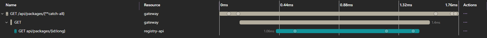

### Якщо Redis недоступний

Помилку Redis `TwoLevelCache` записує як попередження й рахує промахом L2, тому сервіс і далі
відповідає з L1 або з бази. Клієнти Redis у `registry-api` та агрегаторі налаштовано з
`BacklogPolicy.FailFast` і таймаутом 1 секунда. Без цього StackExchange.Redis тримав кожну команду в
черзі до 5 секунд, і `PUT` при зупиненому Redis тривав 10,8 секунди; тепер той самий запит займає
близько 0,1 секунди. Коли Redis запускають знову, клієнти під’єднуються самі.

### gRPC-контракти

| Файл | Сервіс | RPC |
| --- | --- | --- |
| `Services/Cicd/Cicd.Api/Protos/cicd.proto` | `devhub.cicd.CicdService` | `GetRunTimeline` |
| `Services/Registry/Registry.Api/Protos/registry.proto` | `devhub.registry.RegistryService` | `GetPackage`, `GetPackagesByIds` |
| `Services/Telemetry/Telemetry.WebApi/Protos/telemetry.proto` | `devhub.telemetry.TelemetryService` | `GetDiscussions`, `GetCrashReports` |

Кожен сервіс підключає свій файл елементом `<Protobuf … GrpcServices="Server" />`, а агрегатор – ті
самі три файли з `GrpcServices="Client"`. Ідентифікатори мають тип `int64`, час –
`google.protobuf.Timestamp`, ціна – повідомлення `DecimalValue` з полями `units` і `nanos`, бо
`double` губить копійки. Номери полів після публікації не змінюються. Якщо змінити номер поля
`download_count` лише на сервері, агрегатор без жодної помилки показує 0 завантажень; саме так
поводиться клієнт, що не знає нового номера.

Реалізації лежать у папках `Grpc` сервісів: `CicdGrpcService`, `RegistryGrpcService`,
`TelemetryGrpcService`. Кожна успадковує згенерований базовий клас; перевіряє запит і повертає
`InvalidArgument`, якщо Id не додатний чи список Id порожній; викликає той самий бізнес-шар, що й
контролери, тож кеш реєстру працює для обох протоколів; перетворює DTO на повідомлення, а доменні
винятки – на статуси, де відсутній запуск чи пакет дає `NotFound`, а не `Internal`. `AddGrpc` у
кожному сервісі підключає `GrpcLoggingInterceptor` із `Platform.ServiceDefaults`; він логує метод,
адресу клієнта, статус і тривалість виклику. gRPC працює через HTTP/2 на тих самих HTTPS-портах, що
й REST.

### Aggregator на gRPC

Агрегатор реєструє клієнти через `AddGrpcClient` з адресами `https://cicd-api`,
`https://registry-api` і `https://telemetry-api`. Їх створює та сама фабрика HttpClient, тож service
discovery, політики стійкості й `CorrelationIdHandler` діють і для gRPC, а `X-Correlation-Id` іде в
метаданих кожного виклику. Кожен виклик має `CancellationToken` і дедлайн, узгоджений з політикою
сервісу: 10 секунд для критичних, 3 – для некритичного. Статуси
`Unavailable` і `DeadlineExceeded` перетворюються на попередження в картці, а не на 500.

Перед будь-яким викликом агрегатор шукає картку в Redis за ключем `aggregator:build-run:{id}:full`.
Повну картку він зберігає на 30 секунд, а картку з попередженнями не зберігає зовсім, щоб тимчасова
відмова сервісу не поверталася з кешу. 30 секунд менше за TTL кешу реєстру, тому картка не буває
новішою за дані, з яких її складено.

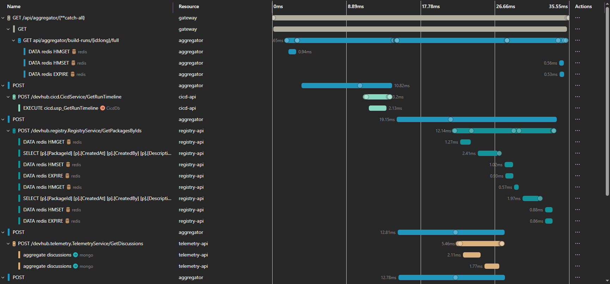

### Метрики кешу

`CacheMetrics` публікує в метрі `Registry.Cache` лічильники `cache.hits` і `cache.misses` з тегом
`cache.level` (L1 або L2) та `cache.invalidations` з причиною. `Platform.ServiceDefaults` додає цей
метр до OpenTelemetry, і лічильники видно у вкладці Metrics ресурсу `registry-api`. Health check
`memory-cache` показує кількість записів, попадань і промахів L1 у відповіді `/health`.

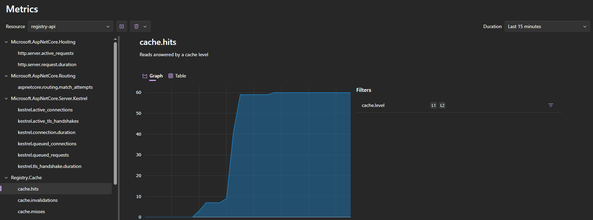

### Порівняння HTTP і gRPC

Тривалість картки запуску 1 через Gateway виміряно окремою консольною програмою, що тримає
з’єднання відкритими між запитами. Спершу 50 запитів на розігрів, далі 400 послідовних і по 50 від кожного паралельного
клієнта. Варіант HTTP – попередня версія агрегатора (коміт `fa09696`), варіант gRPC – поточна. Щоб
кеш картки не вплинув на результат, Redis під час виміру було зупинено.

| Клієнтів | HTTP, медіана / p95 | gRPC, медіана / p95 | Карток за секунду, HTTP → gRPC |
| --- | --- | --- | --- |
| 1 | 12,05 / 18,01 мс | 10,28 / 14,64 мс | – |
| 8 | 52,64 / 101,53 мс | 34,45 / 49,15 мс | 140 → 224 |
| 32 | 126,78 / 233,70 мс | 116,51 / 172,66 мс | 229 → 270 |

Окремий виклик сервісу на localhost триває майже однаково, різниця не перевищує 0,3 мс. Мережевої
затримки тут немає, а HTTP/1.1 теж тримає з’єднання відкритими. Різниця з’являється під
навантаженням: HTTP/2 пропускає всі виклики до одного сервісу через одне з’єднання, і gRPC дає на
18–60 % більше карток за секунду, а p95 нижчий на 26–52 %. Частину виграшу дає кеш у пам’яті реєстру:
у попередній версії його не було.

## Стійкість, метрики й health checks

### Політики стійкості

`Platform.ServiceDefaults` додає Standard Resilience Handler до кожного `HttpClient` через
`ConfigureHttpClientDefaults`, а gRPC-клієнти створює та сама фабрика. Клієнти агрегатора мають власні
налаштування, тож кожен спершу прибирає стандартний обробник викликом `RemoveAllResilienceHandlers()`
і лише потім додає свій; два обробники на одному клієнті не нашаровуються, а значення, що відрізняють
критичні сервіси від некритичного, лежать у записі `ServicePolicy` (`Critical` і `NonCritical`), звідки
`ResilienceExtensions` переносить їх у Polly й у `ServiceConfig` gRPC-каналу. Розмикання ланцюга записується в лог з рівнем Error, напіввідкритий і
закритий стан – з рівнем Information. Метр `Polly` підключено в `Platform.ServiceDefaults`, тому
повтори, таймаути й переходи circuit breaker видно в метриці `resilience.polly.strategy.events` з
тегом `event.name`. Обґрунтування значень – у таблиці на початку README.

Redis лишається необов’язковою залежністю. Помилку Redis кеш реєстру й агрегатор записують як
попередження й читають дані з бази або із сервісів (розділ «Якщо Redis недоступний»).

### Бізнес-метрики

| Метр | Інструмент | Тип | Теги |
| --- | --- | --- | --- |
| `Cicd.Api` | `build_runs.queued` | лічильник | `trigger.kind` |
| `Cicd.Api` | `build_runs.completed` | лічильник | `run.status` |
| `Cicd.Api` | `build_runs.operation.duration`, мс | гістограма | `operation`, `status` |
| `Registry.Api` | `packages.created`, `packages.license_price_changed` | лічильники | `license.kind` (`free`, `commercial`) |
| `Registry.Api` | `packages.operation.duration`, мс | гістограма | `operation`, `status` |
| `Registry.Api` | `registry.cache.entries` | `ObservableGauge` | – |
| `Telemetry.WebApi` | `discussions.created` | лічильник | `discussion.category` |
| `Telemetry.WebApi` | `discussions.operation.duration`, мс | гістограма | `operation`, `status` |

Класи метрик лежать у папках `Metrics` сервісів і зареєстровані як Singleton. Кожен створює метр
через `IMeterFactory` з назвою свого сервісу, а `Platform.ServiceDefaults` підключає метр за назвою
застосунку. Лічильник зростає одразу після успішної операції. Тривалість контролер записує в обох
випадках: і коли операція вдалася, і коли закінчилася винятком (`status` = `success` або `failure`).
Gauge читає кількість записів кешу L1 у момент збору метрик, не опитуючи базу. Теги мають кілька можливих значень і
ніколи не містять ідентифікаторів, щоб не плодити часових рядів.

### Health checks

| Сервіс | Перевірка | Статус збою | Теги |
| --- | --- | --- | --- |
| `cicd-api` | `cicd-db` (`SELECT 1`), `agent-pool` (є вільний агент) | Unhealthy, Degraded | `database`, `sql`, `ready`; `ready` |
| `registry-api` | `registry-db` (`SELECT 1`), `redis-cache` (`PING`) | Unhealthy, Degraded | `database`, `sql`, `ready`; `cache`, `redis`, `ready` |
| `telemetry-api` | `telemetry-db` (ping) | Unhealthy | `database`, `mongodb`, `ready` |
| `aggregator` | `cicd-api`, `registry-api`, `telemetry-api` (gRPC Health), `redis-cache` | Unhealthy, Unhealthy, Degraded, Degraded | `grpc`, `downstream`, `ready`; `cache`, `redis`, `ready` |

Таймаут перевірок баз даних – 5 секунд, Redis – 3, gRPC-перевірки агрегатора – 2. Кожен сервіс
відповідає за стандартним gRPC Health Checking Protocol (`AddGrpcHealthChecks`,
`MapGrpcHealthChecksService`). Його статус залежить лише від перевірок з тегом `database`, тож
зупинений Redis не робить сервіс недоступним для агрегатора. `GrpcDependencyHealthCheck` в агрегаторі
викликає `Health.HealthClient.Check` з коротким дедлайном, а `RpcException` записує в лог.

`MapDefaultEndpoints()` публікує ендпоінти в будь-якому середовищі:

| Ендпоінт | Що перевіряє | Відповідь |
| --- | --- | --- |
| `/health/live` | лише сам процес (перевірка `self` з тегом `live`) | `Healthy` |
| `/health/ready` | перевірки з тегом `ready` | JSON зі статусом, тривалістю й даними кожної перевірки |
| `/health` | усі перевірки | той самий JSON |

`AppHost.cs` додає `WithHttpHealthCheck("/health/ready")` до трьох сервісів, агрегатора й Gateway.
Dashboard показує стан кожного ресурсу, а `WaitFor` чекає готовності залежності, а не лише запуску.

### Перевірка

1. У Dashboard зупиніть `telemetry-api` (Stop) і кілька разів запросіть картку запуску 1. Перша
   картка приходить приблизно за 2 секунди, наступні – за 20 мс із попередженням: circuit breaker
   розімкнувся. У Structured logs є запис «Circuit for telemetry-api (non-critical) opened», у Metrics
   агрегатора `resilience.polly.strategy.events` показує `OnRetry`, `OnTimeout` і `OnCircuitOpened`.
   Після Start і 30 секунд розмикання картка знову повна.
2. Зупиніть `redis`. `GET /health/ready` у `registry-api` повертає 200 зі статусом `Degraded`, а
   запити до пакетів і картки обробляються далі.
3. Зупиніть `sql`. `GET /health/live` відповідає 200, а `GET /health/ready` у `cicd-api` і
   `registry-api` – 503.
4. Поставте в чергу кілька запусків (`POST /api/build-runs`). У Metrics ресурсу `cicd-api` лічильник
   `build_runs.queued` зростає з фільтром за `trigger.kind`, а `build_runs.operation.duration`
   показує розподіл тривалостей.

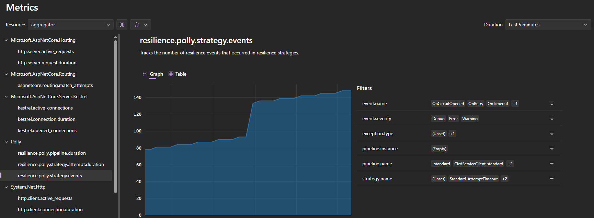

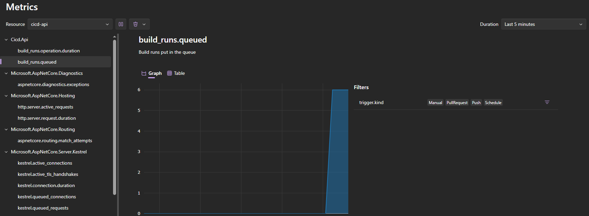

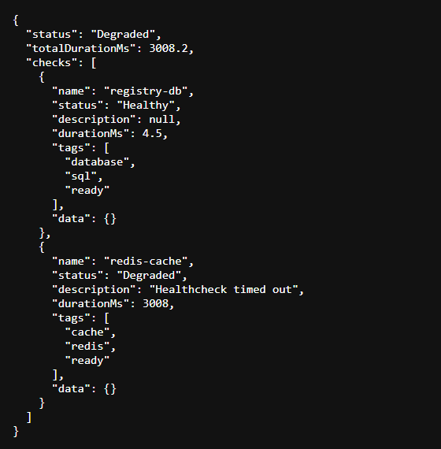

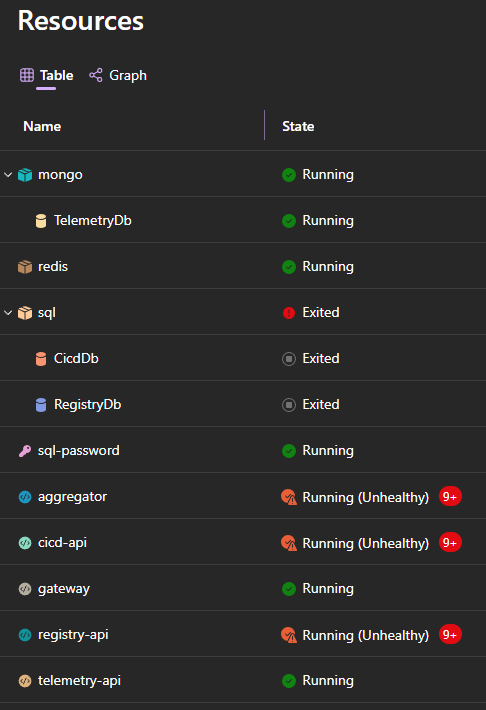

## Подієва взаємодія через RabbitMQ

У політиці дублювання частину копій позначено як «оновлюється подіями з Реєстру»: `cicd.Pipeline.PackageKey`,
назва й ключ пакета в `discussions` і `packageInsights`. Тепер ці події існують. Реєстр публікує в RabbitMQ
кожну зміну пакета, а сервіс збірок і сервіс телеметрії оновлюють свої копії самі, не звертаючись до реєстру.
Копія відстає від реєстру на частки секунди. Поля-знімки події не змінюють.

### RabbitMQ в AppHost

`AppHost.cs` додає брокер викликом `AddRabbitMQ("messaging").WithDataVolume().WithManagementPlugin()`. Том
зберігає черги й повідомлення між перезапусками, а плагін керування відкриває веб-інтерфейс: у Dashboard це
ендпоінт `management` ресурсу `messaging`, користувач `guest`, пароль – параметр `messaging-password` у user
secrets AppHost. Посилання на брокер із `WaitFor` отримують `registry-api`, який публікує події, та
`cicd-api` і `telemetry-api`, які їх споживають. Кожен сервіс підключається викликом
`builder.AddRabbitMQClient("messaging")` з пакета `Aspire.RabbitMQ.Client.v7`, що реєструє один
`IConnection` на застосунок і health check брокера; канали `IChannel` з асинхронним API RabbitMQ.Client 7.x
сервіс відкриває для окремих операцій, а з’єднання після перезапуску брокера відновлюється само разом з
підписками споживачів. Звичайний пакет `Aspire.RabbitMQ.Client` версії 9.5.2 залежить від
RabbitMQ.Client 6.x, тому не підходить. Вбудоване трасування клієнта вимкнено (`DisableTracing = true`),
бо контекст через брокер передає власний код (розділ «Трасування»).

Контейнери SQL Server, MongoDB, Redis і RabbitMQ мають сталі імена `devhub-sql`, `devhub-mongo`,
`devhub-redis` і `devhub-rabbitmq`, мітку `com.docker.compose.project=devhub`, за якою Docker Desktop
показує їх однією групою, і життєвий цикл `ContainerLifetime.Persistent`. Після зупинки AppHost вони
працюють далі, а наступний запуск бере ті самі контейнери; зупиняє їх `docker stop`.

### Топологія

Топологію оголошує код під час старту (`Platform.EventBus/EventBusTopology.cs`). Повторне оголошення тієї
самої черги нічого не змінює.

| Об’єкт | Тип | Параметри |
| --- | --- | --- |
| `registry-events` | exchange, topic, durable | події реєстру з ключами `package.*` |
| `registry-events.dlx` | exchange, direct, durable | dead letter exchange |
| `cicd.registry-sync` | черга, durable | binding `package.*`; `x-dead-letter-exchange` = `registry-events.dlx`, `x-dead-letter-routing-key` = `cicd.registry-sync` |
| `telemetry.registry-sync` | черга, durable | binding `package.renamed`; DLX так само, з ключем `telemetry.registry-sync` |
| `<черга>.retry` | черга, durable | `x-message-ttl` 5000; після TTL повідомлення повертається в основну чергу |
| `<черга>.dlq` | черга, durable | прив’язана до `registry-events.dlx` з ключем основної черги |

Сервіс збірок тримає копію всього пакета, тому підписаний на всі події пакетів. Телеметрії потрібна лише
назва, і її черга отримує тільки перейменування. Dead letter exchange має тип direct, а кожна черга передає
в нього власну назву як ключ. Повідомлення, відхилене сервісом збірок, потрапляє лише в
`cicd.registry-sync.dlq`, а не в DLQ кожного споживача.

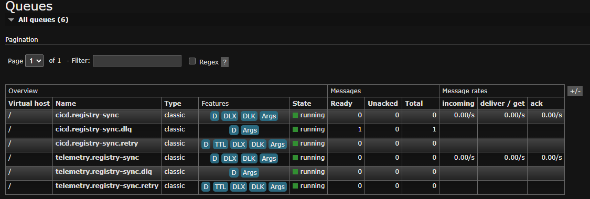

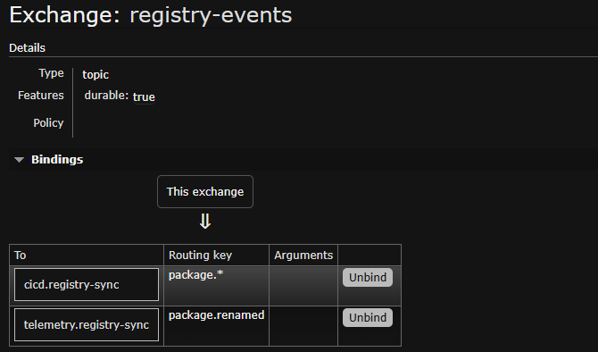

### Події реєстру

| Подія | Ключ | Операція реєстру | Споживачі |
| --- | --- | --- | --- |
| `PackageCreatedEvent` | `package.created` | `POST /api/packages` | збірки |
| `PackageRenamedEvent` | `package.renamed` | `PUT /api/packages/{id}/name` | збірки, телеметрія |
| `PackageLicensePriceChangedEvent` | `package.license_price_changed` | `PUT /api/packages/{id}/license-price` | збірки |
| `PackageDeletedEvent` | `package.deleted` | `DELETE /api/packages/{id}` | збірки |

Базовий record `IntegrationEvent` у `Platform.EventBus` має `EventId`, `OccurredAt` і `CorrelationId`.
Конкретні події – незмінні record у `Services/Registry/Registry.Api/IntegrationEvents/Events/`. Їхні копії
лише з тими полями, які читає споживач, лежать у папках `IntegrationEvents` сервісу збірок і сервісу
телеметрії; спільної збірки з контрактами немає. Кожна подія несе повний поточний знімок пакета: Id, slug
видавця, назву, ключ і ціну ліцензії, а також попереднє значення зміненого поля. Тому споживач оновить копію
з будь-якої події, навіть якщо пропустив `PackageCreatedEvent`. Перейменування – нова операція реєстру. Назва
входить у ключ `<publisher>/<name>`, отже разом з нею змінюється ключ, а посилання за Id лишаються чинними.

### Публікація після збереження

Подія не може піти раніше за зміну, яку описує. `PackageService` записує подію в таблицю
`registry.OutboxMessage` тим самим `SaveChangesAsync`, що й зміну пакета, а одразу після збереження викликає
`PublishPendingAsync`. Якщо запис у базу не вдався, події немає навіть у таблиці. Створення пакета загорнуто
в явну транзакцію, бо Id, потрібний події, з’являється тільки після першого збереження. `RabbitMqEventPublisher`
серіалізує подію в JSON (`System.Text.Json`, camelCase) і публікує її з `Persistent = true`, тож повідомлення
переживе перезапуск брокера; `ContentType` має значення `application/json`, `MessageId` дорівнює `EventId`,
у `Type` стоїть назва події, а заголовки `x-correlation-id` та `x-schema-version` несуть ідентифікатор запиту
й версію схеми. Канал працює з підтвердженнями видавця, тому опублікованим рядок стає лише тоді, коли брокер
прийняв повідомлення.

Коли брокер недоступний, запит однаково отримує 204, а рядок лишається неопублікованим разом з текстом
помилки. `OutboxDispatcher` кожні 5 секунд перевіряє таблицю й публікує рядки, старші за 10 секунд. Під час
перевірки із зупиненим RabbitMQ зміна ціни відповіла за 62 мс; після запуску брокера подію опубліковано з
чотирнадцятої спроби, і копія в сервісі збірок отримала нову ціну.

### Споживачі

`RabbitMqConsumer` у `Platform.EventBus` – базовий `BackgroundService`. У `ExecuteAsync` він створює канал,
оголошує топологію своєї черги, задає `BasicQos` з `prefetchCount` 10 і підписується через
`AsyncEventingBasicConsumer` з `BasicConsumeAsync(autoAck: false)`. З кожного повідомлення він бере тип із
`BasicProperties.Type`, десеріалізує тіло й передає подію обробнику цього типу, створеному в окремому
DI-scope, тож репозиторії й Unit of Work живуть рівно стільки, скільки обробка одного повідомлення; сервіси
успадковують від нього `RegistryEventsConsumer`, де задано чергу, ключі й типи подій, і реєструють його
через `AddHostedService`. Під час зупинки застосунку споживач скасовує підписку за
`stoppingToken` і чекає, поки завершиться обробка поточного повідомлення.

| Результат обробки | Дія | Рівень логу |
| --- | --- | --- |
| Успіх | `BasicAckAsync` | Information |
| Некоректний JSON, невідомий тип, новіша версія схеми, помилка валідації | `BasicNackAsync(requeue: false)` → `registry-events.dlx` → DLQ | Error |
| Тимчасовий збій: база недоступна, таймаут | повторна публікація в `<черга>.retry` з `x-retry-count` + 1, оригінал підтверджується | Warning |
| Невдала третя повторна спроба | `BasicNackAsync(requeue: false)` → DLQ | Error |

Повторювати через requeue не можна: повернене повідомлення приходить без змін, і лічильник у заголовку не
зростає. Тому споживач публікує повідомлення заново, причому не в `registry-events`, а через стандартний
exchange прямо в чергу `.retry` свого споживача. Такий повтор не дістається іншим підписникам, а 5 секунд TTL дають
базі час відновитися. Кожен запис логу обробки має `EventId`, тип події, `CorrelationId`, назву черги й номер
спроби; обробники додають Id пакета.

### Ідемпотентність і порядок подій

RabbitMQ доставляє повідомлення щонайменше один раз, і та сама подія може прийти двічі. Обробники сервісу
збірок (`Services/Cicd/Cicd.Api/IntegrationEvents/Handlers/`) в одній транзакції Unit of Work вставляють
`EventId` у таблицю `cicd.ProcessedEvent` з первинним ключем `EventId` і оновлюють копію. Порушення ключа
(помилка 2627) означає, що подію вже оброблено: обробник записує це в лог і відкочує транзакцію. Копія
змінюється, тільки якщо `OccurredAt` події новіший за `SourceChangedAt` рядка. Подія, що після повторів прийшла
пізніше за новішу, нічого не перезаписує.

MongoDB сервісу телеметрії працює без набору реплік, тож транзакцій на кілька документів там немає. Його
`UpdateMany` змінює лише документи, у яких `packageSyncedAt` не новіший за подію, і повторне застосування тієї
самої події нічого не змінює. Після оновлення `EventId` записується в колекцію `processedEvents` з унікальним
`_id`. Оновлення збільшує й `version` обговорення: редагування, почате до перейменування, отримає 409 і не
запише стару назву назад.

### Реплікація копій

| Копія | Що робить подія |
| --- | --- |
| `cicd.Package` (нова таблиця, локальний довідник пакетів) | вставляє або оновлює назву, ключ, видавця й ціну; видалення позначає `IsDeleted` |
| `cicd.Pipeline.PackageKey` | отримує новий ключ після перейменування |
| `discussions.packageName`, `packageKey`, `publisherSlug` | нові значення в усіх обговореннях пакета |
| `packageInsights.packageName`, `packageKey`, `publisherSlug` | те саме для зведень |
| `cicd.Artifact`, `crashReports`, `buildEvents` | нічого, це знімки |

Завершення запуску збірки бере назву, ключ і ціну ліцензії з `cicd.Package`, і артефакт зберігає знімок ціни
в новому стовпці `cicd.Artifact.LicensePrice`. Після зміни ціни в реєстрі нова ціна з’являється в
`cicd.Package` за кілька секунд; ціна вже зібраних артефактів лишається тією, що була на момент збірки, а
артефакти, зібрані до появи копії, мають у цьому стовпці NULL, бо ціни на той момент сервіс збірок не знав.

### Трасування

Перед публікацією `TracePropagation` створює span типу Producer і записує його контекст у заголовок
`traceparent` у форматі W3C через пропагатор OpenTelemetry. Споживач читає заголовок (значення приходить як
`byte[]`), відновлює контекст і починає span типу Consumer з тегами `messaging.system`,
`messaging.destination.name` і `messaging.message.id`. `Platform.ServiceDefaults` підключає джерело
`Platform.Messaging`, тому запит до Gateway, публікацію, обробку в обох сервісах і запити до баз видно в
одному trace. Рядок outbox зберігає контекст запиту, і подія, яку диспетчер опублікував через хвилину, однаково
потрапляє в trace свого запиту. Логи обох споживачів можна відфільтрувати за `CorrelationId` з заголовка
`x-correlation-id`.

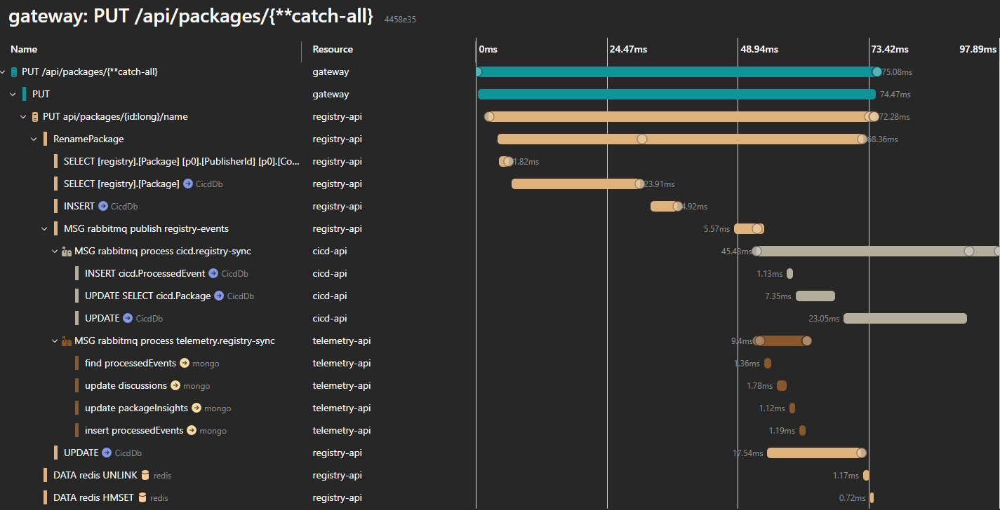

### Перевірка

1. Змініть ціну:
   `curl -i -X PUT -H "$AUTH" $GW/api/packages/1/license-price -H "Content-Type: application/json" -d '{"licensePrice":59.00}'`.
   За кілька секунд `SELECT * FROM cicd.Package` у базі `DevHub_Cicd` показує 59.00 для пакета 1, а
   артефакт 0.9.1 у `cicd.Artifact` зберігає 49.00.
2. Перейменуйте пакет:
   `curl -i -X PUT -H "$AUTH" $GW/api/packages/2/name -H "Content-Type: application/json" -d '{"name":"devhub-identity"}'`.
   Обидва обговорення пакета 2, рядок `cicd.Package` і конвеєр «devhub-auth CI» отримують ключ
   `platform-team/devhub-identity`, а артефакти й звіт про збій зберігають стару назву.
3. У Management UI опублікуйте ту саму подію ще раз з тим самим `message_id`. Лог споживача містить запис
   «Duplicate … skipped», у `cicd.ProcessedEvent` нового рядка немає.
4. У Dashboard зупиніть `cicd-api`, змініть кілька цін і запустіть сервіс знову. Поки його зупинено,
   повідомлення чекають у `cicd.registry-sync`, а після запуску всі обробляються.
5. Опублікуйте в `registry-events` з ключем `package.license_price_changed` тіло з некоректним JSON.
   Повідомлення потрапляє в `cicd.registry-sync.dlq` із заголовком `x-death` і причиною `rejected`.
6. Зупиніть `sql` і опублікуйте коректну подію. У лозі `cicd-api` з’являються записи «Retry 1/3», «2/3» і
   «3/3» з інтервалом 5 секунд, після них повідомлення йде в DLQ.

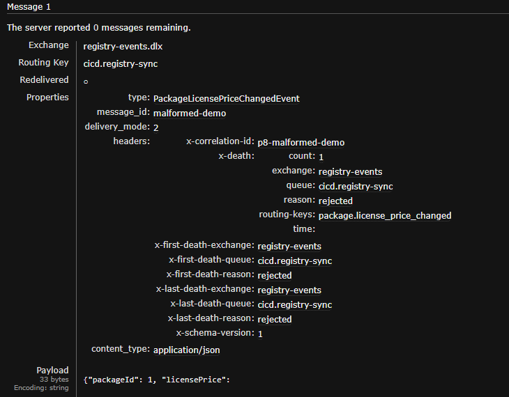

## Автентифікація та авторизація

Платформу захищають три постачальники токенів, і жоден не замінює інший. `Auth.Api` видає власні JWT
користувачам DevHub. Duende IdentityServer обслуговує OAuth 2.0 для Postman, Swagger і агрегатора. Keycloak
тримає ролі й дозволи, які описує проєкт Pulumi. Gateway перевіряє токен до проксування, а кожен сервіс
перевіряє його ще раз сам і до постачальника на кожен запит не звертається. Обробник токена сервіс обирає
за полем `iss` (`PlatformAuthentication.SchemeByIssuer` у `Platform.ServiceDefaults`), тому той самий
`[RequirePermission]` приймає токен будь-якого з трьох.

### Схема рішення

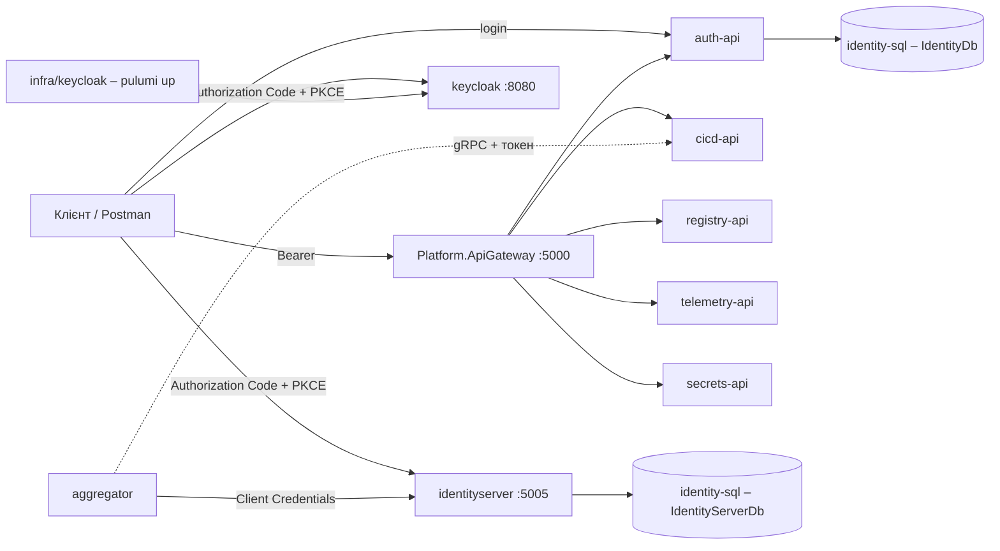

Бази користувачів лежать в окремому контейнері SQL Server `devhub-identity-sql`, а не поруч із бізнес-даними.
Сервіс `secrets-api` – сховище секретів конвеєрів (ключі розгортання, сертифікат підпису пакетів, токен
публікації в реєстр). Значень він не повертає, лише ім’я, версію й відбиток, і доступ до нього має тільки
адміністратор.

### Секрети й запуск

1. Збережіть секрети AppHost. Значення нижче – локальні навчальні:

   ```bash
   dotnet user-secrets set "Parameters:identity-sql-password" "Kostenuk#Identity26" --project Platform.AppHost
   dotnet user-secrets set "Parameters:jwt-secret" "kostenuk-devhub-auth-signing-key-2026" --project Platform.AppHost
   dotnet user-secrets set "Parameters:auth-admin-password" "Kostenuk#Admin26" --project Platform.AppHost
   dotnet user-secrets set "Parameters:postman-client-secret" "kostenuk-postman-client-26" --project Platform.AppHost
   dotnet user-secrets set "Parameters:aggregator-client-secret" "kostenuk-aggregator-client-26" --project Platform.AppHost
   dotnet user-secrets set "Parameters:identityserver-user-password" "Kostenuk#Idsrv26" --project Platform.AppHost
   dotnet user-secrets set "Parameters:keycloak-admin-password" "Kostenuk#Keycloak26" --project Platform.AppHost
   ```

2. Запустіть `dotnet run --project Platform.AppHost`. Перший старт завантажує образ Keycloak, а `auth-api` і
   `identityserver` застосовують свої міграції й створюють ролі, адміністратора `kostenuk.admin` і клієнтів.
3. Встановіть Pulumi CLI (`winget install Pulumi.Pulumi`) і розгорніть realm:

   ```bash
   cd infra/keycloak
   export PULUMI_CONFIG_PASSPHRASE="kostenuk-pulumi-stack-26"
   pulumi login --local
   pulumi stack init dev
   pulumi config set --secret adminPassword "Kostenuk#Keycloak26"
   pulumi config set --secret testUserPassword "Kostenuk#Temp26"
   pulumi preview
   pulumi up
   pulumi stack output
   pulumi stack output ClientSecrets --show-secrets
   ```

4. Імпортуйте в Postman колекцію `docs/postman/devhub-identity.postman_collection.json` і заповніть змінні
   `postmanSecret`, `aggregatorSecret` і `keycloakPostmanSecret`.

`pulumi preview` показує 82 ресурси: realm, клієнтів, ролі, політики, дозволи й чотирьох користувачів. Файл
стека `Pulumi.dev.yaml` з зашифрованими паролями лишається на машині й до репозиторію не потрапляє.
`pulumi destroy` прибирає realm після демонстрації.

### Auth Service: ASP.NET Identity і JWT

`Services/Auth/Auth.Api` має власну базу `IdentityDb` і власні `ApplicationUser` та `ApplicationDbContext`;
міграція `InitialIdentity` створює таблиці `AspNet*` і `RefreshTokens`. Пароль – щонайменше 8 символів з
цифрою, великою й малою літерою та спецсимволом. Після п’яти невдалих спроб обліковий запис блокується на
15 хвилин, а вхід без підтвердженого email заборонено.

Access-токен живе 15 хвилин і містить `sub`, `unique_name`, `email` і по одному claim `role` на роль, тож
сервіси перевіряють ролі без звернення до бази. Refresh-токен живе 7 днів і приходить лише в cookie
`devhub_refresh_token` з атрибутами `HttpOnly`, `Secure`, `SameSite=Strict` і `Path=/auth`. У базі зберігається
тільки його SHA-256. Кожне оновлення відкликає старий токен і посилається з нього на новий. Якщо хтось подає
вже відкликаний токен, сервіс відкликає всі активні токени користувача: так викрадений токен перестає
працювати і в нападника, і в жертви.

Токени підтвердження email і скидання пароля живуть дві години й одноразові. Після `ConfirmEmailAsync` сервіс
оновлює security stamp, тому той самий токен удруге не спрацює; скидання і зміна пароля оновлюють stamp самі
й відкликають усі refresh-токени. Лист у розробці замінює запис у лозі `auth-api` з токеном.

| Endpoint | Доступ |
| --- | --- |
| `POST /auth/register`, `/login`, `/refresh-token`, `/verify-email`, `/resend-verification`, `/forgot-password`, `/reset-password` | анонімно |
| `POST /auth/revoke-token`, `/logout`, `/change-password` | автентифікований |
| `GET /users`, `DELETE /users/{id}`, `POST /users/{id}/roles`, `DELETE /users/{id}/roles/{role}` | `[Authorize(Roles = "Admin")]` |
| `GET /users/{id}`, `PUT /users/{id}`, `GET /users/{id}/refresh-tokens` | власник (`sub` = `{id}`) або Admin |
| `GET /users/{id}/roles` | автентифікований |

Ролі `User` і `Admin` сервіс створює під час старту, а нового користувача реєструє з роллю `User`. Gateway
маршрутизує `/auth/**` без перевірки токена, бо цей сервіс сам вирішує, які з його endpoint-ів анонімні, а
`/users/**` і всі маршрути API пропускає лише з чинним токеном. У бізнес-логіці реєстр бере ім’я користувача
з токена: `CreatedBy` і `UpdatedBy` пакета заповнює `HttpContextCurrentUser`.

### Duende IdentityServer

`Platform.IdentityServer` працює на порту 5005, бо 5000 зайнятий Gateway. Він має окрему базу
`IdentityServerDb`, власних користувачів ASP.NET Identity і сховища конфігурації та операційних даних на EF:
`AddIdentityServer().AddAspNetIdentity().AddConfigurationStore().AddOperationalStore()`. Міграції трьох контекстів
лежать у `Migrations/PersistedGrantDb`, `Migrations/ConfigurationDb` і `Migrations/ApplicationDb`. Сторінки входу,
виходу й згоди взято з Quickstart UI шаблону Duende без змін, разом із його заголовками ліцензії.

| Ресурс | Scopes |
| --- | --- |
| `cicd_api` | `cicd.read`, `cicd.write` |
| `registry_api` | `registry.read`, `registry.write` |
| `telemetry_api` | `telemetry.read` |
| `secrets_api` | `secrets.read`, `secrets.write` |

| Клієнт | Потік | Особливості |
| --- | --- | --- |
| `postman` | Authorization Code | секрет, PKCE, refresh-токени, callback `https://oauth.pstmn.io/v1/callback` |
| `aggregator` | Client Credentials | секрет, лише `cicd.read`, `registry.read`, `telemetry.read` |
| `swagger` | Authorization Code | публічний клієнт без секрету, PKCE обов’язковий, Swagger UI сервісів CI/CD і реєстру |

Сервіси приймають токени IdentityServer через `AddJwtBearer("identityserver")` з `Authority` і власним
`Audience`. Агрегатор бере токен Client Credentials, тримає його до хвилини перед закінченням строку й додає
до кожного gRPC-виклику, а gRPC-сервіси пропускають лише токен зі scope читання
(`[Authorize(Policy = "cicd.read")]`). У такому токені немає `sub`: він описує сервіс, а не людину.

### Keycloak і Pulumi

AppHost запускає Keycloak через `AddKeycloak("keycloak", 8080).WithDataVolume()`, а сервіси отримують на нього
посилання й налаштовують `AddKeycloakJwtBearer` на realm `DevHub`. Realm, клієнтів, ролі й користувачів створює
проєкт `infra/keycloak`:

| Файл | Що описує |
| --- | --- |
| `Pulumi.yaml`, `Program.cs` | provider з обліковим записом адміністратора, realm (реєстрація, скидання пароля, «запам’ятати мене», тема), outputs |
| `PermissionMatrix.cs` | ролі `admin`, `manager`, `user`, `guest` і дозволи кожної ролі на кожному resource server |
| `ResourceServer.cs` | resource server `cicd-api`, `registry-api` або `secrets-api`: scopes, ресурс, рольові політики, scope-дозволи, клієнтські ролі |
| `KeycloakClientFactory.cs`, `ClientScopeExtensions.cs` | фабрика клієнтів `postman`, `swagger`, `aggregator`; extension-методи для default scopes, audience-мапперів і маппера дозволів |
| `TestUsers.cs` | користувачі `devhub-admin`, `devhub-manager`, `devhub-user`, `devhub-guest` з підтвердженим email, роллю й тимчасовим паролем |

| Resource server | Scopes |
| --- | --- |
| `cicd-api` | `cicd:read`, `cicd:create`, `cicd:update`, `cicd:delete`, `cicd:approve` |
| `registry-api` | `registry:read`, `registry:create`, `registry:update`, `registry:delete`, `registry:publish` |
| `secrets-api` | `secrets:read`, `secrets:rotate`, `secrets:revoke` |

| Роль | `cicd-api` | `registry-api` | `secrets-api` |
| --- | --- | --- | --- |
| `admin` | усі дозволи | усі дозволи | усі дозволи |
| `manager` | read, update, approve | read, update, publish | – |
| `user` | read, create | read | – |
| `guest` | – | read | – |

`approve` у CI/CD – дозвіл запустити збірку з черги на агенті (`POST /api/build-runs/{id}/start`), `publish` у
реєстрі – показати пакет у реєстрі чи сховати його (`relist`, `unlist`). Розробник ставить збірку в чергу,
менеджер релізів її погоджує, а видаляти історію може лише адміністратор. До секретів конвеєрів доступ має
тільки `admin`: це найчутливіший ресурс системи.

Дозволи потрапляють у токен двома шляхами. Кожен дозвіл – клієнтська роль resource server, ролі realm складено
з них як composite roles, а маппер «client roles as permissions» записує їх у claim `permissions` кожного
access-токена. Окрім того, resource servers мають Authorization Services з рольовими політиками й
scope-дозволами за тією самою матрицею, тому запит `grant_type=urn:ietf:params:oauth:grant-type:uma-ticket`
повертає RPT із `authorization.permissions` для одного resource server. Обидва варіанти читає
`KeycloakPermissionHandler`.

### Перевірка дозволів у сервісах

Кожен endpoint сервісів CI/CD, реєстру й секретів позначено `[RequirePermission("…")]`. Атрибут посилається на
політику з тим самим іменем, а політика містить `PermissionRequirement`. Для цієї вимоги зареєстровано три
обробники, і досить згоди одного з них: `KeycloakPermissionHandler` читає `permissions` та
`authorization.permissions`, `ScopePermissionHandler` перетворює scope IdentityServer на дозволи (`cicd.read` дає
`cicd:read`, `cicd.write` – решту), `RolePermissionHandler` робить те саме з ролями `Auth.Api` (`Admin` має все,
`User` – роль `user` з матриці). Код лежить у `<Сервіс>.Api/Authorization` кожного сервісу: дозволи визначає й
перевіряє сам сервіс, Keycloak на кожен запит не опитується. Сервіс телеметрії в матрицю не входить і вимагає
лише чинного токена.

### Матриця дозволів

Нижче – фактичні коди відповіді через Gateway з токенами Keycloak чотирьох користувачів. Запити на зміну
адресовано записам, яких немає, тож 400 і 404 означають, що запит пройшов авторизацію й зупинився на
валідації чи пошуку. 403 – відмова в дозволі.

| Дозвіл | Endpoint | admin | manager | user | guest |
| --- | --- | --- | --- | --- | --- |
| `cicd:read` | `GET /api/pipelines` | 200 | 200 | 200 | 403 |
| `cicd:read` | `GET /api/build-runs/1` | 200 | 200 | 200 | 403 |
| `cicd:create` | `POST /api/pipelines` | 400 | 403 | 400 | 403 |
| `cicd:create` | `POST /api/build-runs` | 400 | 403 | 400 | 403 |
| `cicd:update` | `POST /api/build-runs/{id}/transition` | 400 | 400 | 403 | 403 |
| `cicd:update` | `POST /api/build-runs/{id}/complete` | 400 | 400 | 403 | 403 |
| `cicd:approve` | `POST /api/build-runs/{id}/start` | 400 | 400 | 403 | 403 |
| `cicd:delete` | `DELETE /api/build-runs/{id}` | 404 | 403 | 403 | 403 |
| `cicd:delete` | `DELETE /api/pipelines/{id}` | 404 | 403 | 403 | 403 |
| `registry:read` | `GET /api/packages` | 200 | 200 | 200 | 200 |
| `registry:read` | `GET /api/tags` | 200 | 200 | 200 | 200 |
| `registry:create` | `POST /api/packages` | 400 | 403 | 403 | 403 |
| `registry:update` | `PUT /api/packages/{id}/license-price` | 404 | 404 | 403 | 403 |
| `registry:update` | `PUT /api/packages/{id}/name` | 404 | 404 | 403 | 403 |
| `registry:publish` | `POST /api/packages/{id}/unlist` | 404 | 404 | 403 | 403 |
| `registry:publish` | `POST /api/packages/{id}/relist` | 404 | 404 | 403 | 403 |
| `registry:delete` | `DELETE /api/packages/{id}` | 404 | 403 | 403 | 403 |
| `secrets:read` | `GET /api/secrets` | 200 | 403 | 403 | 403 |
| `secrets:rotate` | `POST /api/secrets/rotate` | 404 | 403 | 403 | 403 |
| `secrets:revoke` | `POST /api/secrets/revoke` | 404 | 403 | 403 | 403 |

На наявному пакеті менеджер отримує 204 на `PUT /api/packages/1/license-price` і 403 на
`DELETE /api/packages/1`, а `UpdatedBy` пакета стає `devhub-manager`.

### Декодовані JWT

Токен `Auth.Api` адміністратора:

```json
{
  "sub": "6a77c546-dbec-454c-b92d-6da01cb406d9",
  "unique_name": "kostenuk.admin",
  "email": "kostenuk.admin@devhub.local",
  "jti": "a0249746-56c3-4f6d-80ca-945fcb939285",
  "role": ["User", "Admin"],
  "exp": 1793034550,
  "iss": "devhub-auth",
  "aud": "devhub-platform"
}
```

Токен Client Credentials агрегатора від IdentityServer, без `sub`:

```json
{
  "iss": "https://localhost:5005",
  "aud": ["cicd_api", "registry_api", "telemetry_api"],
  "scope": ["cicd.read", "registry.read", "telemetry.read"],
  "client_id": "aggregator",
  "jti": "24EBF0A4CED69D7B29DFBCA8059D2863",
  "exp": 1793037250
}
```

Токен Keycloak користувача `devhub-manager` і RPT того ж користувача для `cicd-api`:

```json
{
  "iss": "http://localhost:8080/realms/DevHub",
  "aud": ["secrets-api", "cicd-api", "registry-api", "telemetry-api", "account"],
  "preferred_username": "devhub-manager",
  "realm_access": { "roles": ["manager", "default-roles-devhub", "offline_access", "uma_authorization"] },
  "permissions": ["cicd:update", "cicd:approve", "cicd:read", "manage-account", "manage-account-links", "view-profile", "registry:read", "registry:publish", "registry:update"],
  "scope": "openid devhub-apis profile email"
}
```

```json
{
  "aud": "cicd-api",
  "preferred_username": "devhub-manager",
  "authorization": {
    "permissions": [
      { "rsname": "cicd-api", "rsid": "7063dd76-f579-4c73-865a-c2bda6f5cf32", "scopes": ["cicd:update", "cicd:approve", "cicd:read"] }
    ]
  }
}
```

`manage-account` і `view-profile` – вбудовані ролі облікового запису Keycloak; жоден endpoint їх не вимагає.

### Колекція Postman

`docs/postman/devhub-identity.postman_collection.json` має чотири папки: реєстрація, сесія, пароль і
користувачі `Auth.Api`; Authorization Code з PKCE і Client Credentials в IdentityServer; RPT і всі endpoint-и
матриці з токеном Keycloak. Для матриці в авторизації папки Keycloak натисніть «Get New Access Token» і
увійдіть потрібним користувачем. Під час першого входу Keycloak попросить замінити тимчасовий пароль.
