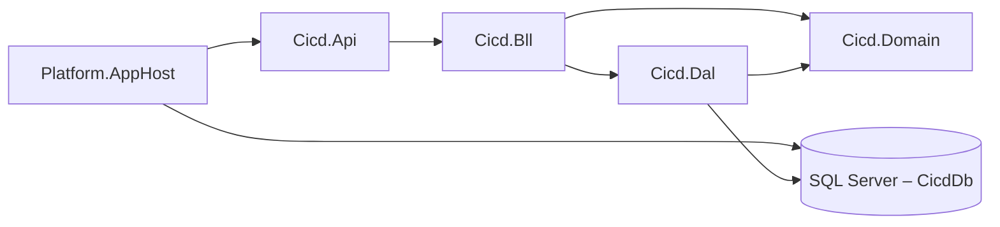
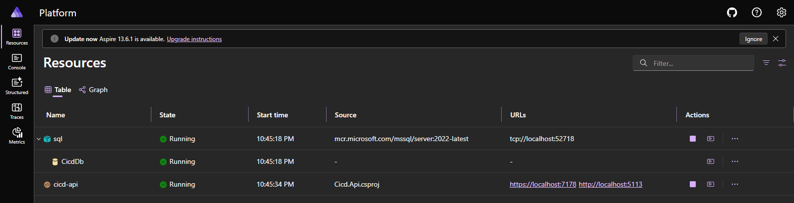

# DevHub

DevHub – внутрішня платформа розробників однієї організації. Команди публікують бібліотеки як
версійовані пакети, CI-конвеєри збирають їх після кожного коміту, а мейнтейнери стежать за
аваріями й обговорюють дефекти пакетів зі споживачами.

Система складається з трьох незалежних контекстів, кожен з яких має власну базу даних; повний опис
контекстів, сутностей і агрегатів наведено в [docs/contexts.md](docs/contexts.md).

| № | Контекст | БД | Технологія | Сутності / колекції |
| --- | --- | --- | --- | --- |
| 1 | Збірки CI/CD | `DevHub_Cicd` | SQL Server + ADO.NET і Dapper | `Pipeline`, `Agent`, `BuildRun`, `BuildRunDetail`, `BuildStep`, `Artifact`, `ArtifactUsage`, `RunStatusHistory` |
| 2 | Реєстр пакетів | `DevHub_Registry` | SQL Server + EF Core (Code First) | `Publisher`, `Package`, `PackageVersion`, `PackageManifest`, `Tag`, `PackageTag` |
| 3 | Телеметрія й обговорення | `devhub_telemetry` | MongoDB | `buildEvents`, `crashReports`, `discussions`, `packageInsights` |

Спільних таблиць між базами немає, як і жодного FOREIGN KEY. Посилання на сутність іншого
контексту – звичайний стовпець або поле з її Id без зовнішнього ключа:

| Де | Поле з Id | На що посилається |
| --- | --- | --- |
| `cicd.Pipeline`, `cicd.Artifact` | `PackageId` | `registry.Package.PackageId` |
| `crashReports` | `packageVersionId`, `packageId` | `registry.PackageVersion`, `registry.Package` |
| `discussions`, `packageInsights` | `packageId` | `registry.Package.PackageId` |
| `buildEvents` | `buildRunId`, `packageId` | `cicd.BuildRun.BuildRunId`, `registry.Package.PackageId` |
| `discussions` | `linkedBuildRunIds[]` | `cicd.BuildRun.BuildRunId` |

Поруч з Id зберігається його читабельна форма: `packageKey` = `"<publisher>/<package>"`,
`versionKey` = `"<publisher>/<package>@<semver>"`, `runKey` = `"<pipeline>#<run number>"`. Це
дубльовані поля, тож кожне з них є в таблиці нижче.

## Політика дублювання

| Поле | Де зберігається | Джерело (власник даних) | Політика узгодженості |
| --- | --- | --- | --- |
| `cicd.Pipeline.PackageKey` | БД збірок (`DevHub_Cicd`) | `registry.Publisher.Slug` + `registry.Package.Name` (Реєстр) | оновлюється подіями з Реєстру |
| `cicd.Artifact.PackageName` | БД збірок (`DevHub_Cicd`) | `registry.Package.Name` (Реєстр) | знімок на момент збірки, не оновлюється |
| `cicd.Artifact.PublisherSlug` | БД збірок (`DevHub_Cicd`) | `registry.Publisher.Slug` (Реєстр) | знімок на момент збірки, не оновлюється |
| `cicd.Artifact.PackageKey` | БД збірок (`DevHub_Cicd`) | `registry.Publisher.Slug` + `registry.Package.Name` (Реєстр) | знімок на момент збірки, не оновлюється |
| `cicd.Artifact.SemVer` | БД збірок (`DevHub_Cicd`) | `registry.PackageVersion.SemVer` (Реєстр) | знімок; опублікована версія незмінна |
| `discussions.packageName`, `discussions.publisherSlug`, `discussions.packageKey` | БД телеметрії (`devhub_telemetry`) | `registry.Package.Name`, `registry.Publisher.Slug` (Реєстр) | оновлюється подіями з Реєстру |
| `packageInsights.packageName`, `packageInsights.publisherSlug`, `packageInsights.packageKey` | БД телеметрії (`devhub_telemetry`) | `registry.Package.Name`, `registry.Publisher.Slug` (Реєстр) | оновлюється подіями з Реєстру |
| `crashReports.packageKey`, `crashReports.versionKey` | БД телеметрії (`devhub_telemetry`) | `registry.Publisher.Slug` + `registry.Package.Name` + `registry.PackageVersion.SemVer` (Реєстр) | знімок на момент аварії; версія незмінна |
| `buildEvents.packageKey` | БД телеметрії (`devhub_telemetry`) | `registry.Publisher.Slug` + `registry.Package.Name` (Реєстр) | знімок на момент події, не оновлюється |
| `buildEvents.pipelineName`, `buildEvents.runNumber`, `buildEvents.runKey` | БД телеметрії (`devhub_telemetry`) | `cicd.Pipeline.Name`, `cicd.BuildRun.RunNumber` (Збірки CI/CD) | знімок на момент події, не оновлюється |

Кожне дубльоване поле має одного власника, а копії тільки читають і ніколи не пишуть назад.
Поля-знімки й поля-посилання БД збірок задокументовано описами `MS_Description` поруч із
колонками (`db/p1/schema.sql`), у MongoDB для цього слугує властивість `description` у JSON Schema
(`db/p3/collections.js`).

## Ключі та конкурентність

Первинні ключі мають тип `BIGINT IDENTITY`. Ключі генерує одне джерело, сама база, тому
послідовна вставка не фрагментує кластерний індекс, а глобально унікальний GUID не потрібен:
інші контексти посилаються на рядок за його Id і нових ключів не створюють.

Таблиці, які можуть змінювати паралельно, мають колонку `RowVersion ROWVERSION` для оптимістичної
конкурентності. Процедури `cicd.usp_TransitionRunStatus` і `cicd.usp_DeleteBuildRun` відхиляють
зміну із застарілою версією рядка (помилки 50021 і 50051).

Для аудиту й м’якого видалення кожна бізнес-таблиця має `CreatedAt`, `CreatedBy`, `UpdatedAt`,
`UpdatedBy` та `IsDeleted`.

## ERD

Проєкт №1, `DevHub_Cicd`:


Проєкт №2, `DevHub_Registry`:


Проєкт №3: приклади документів кожної колекції в [docs/examples/](docs/examples).

## Розгортання

Потрібні SQL Server (наприклад, `(localdb)\MSSQLLocalDB`) із `sqlcmd` і Docker для MongoDB.
Усі скрипти ідемпотентні: перед кожною вставкою вони перевіряють, що запису ще немає, тож
повторний запуск не створює дублікатів і не видаляє даних.

### Проєкт №1 – `DevHub_Cicd`

```bash
sqlcmd -S "(localdb)\MSSQLLocalDB" -b -i db/p1/schema.sql
sqlcmd -S "(localdb)\MSSQLLocalDB" -b -i db/p1/procedures.sql
sqlcmd -S "(localdb)\MSSQLLocalDB" -b -i db/p1/seed.sql
sqlcmd -S "(localdb)\MSSQLLocalDB" -b -i db/p1/security.sql -v CicdAppPassword="Repetovskyi#Cicd26"
sqlcmd -S "(localdb)\MSSQLLocalDB" -b -i db/p1/verify.sql
```

`schema.sql` створює базу, таблиці, індекси й представлення; `procedures.sql` – шість
збережуваних процедур; `seed.sql` – тестові дані; `security.sql` – окремий логін застосунку
`devhub_cicd_app` з доступом лише до `DevHub_Cicd` і схеми `cicd`, а також роль читача без права
запису; `verify.sql` перевіряє ключі, обмеження, індекси, процедури й доступи та завершується
помилкою, якщо не пройшла хоч одна перевірка. Пароль логіна передають під час розгортання
через `-v`. Пароль у команді навчальний і призначений для локальної бази, але відповідає політиці
паролів Windows, тож SQL Server приймає його без змін.

Запуск процедур:

```sql
DECLARE @PipelineId BIGINT = (SELECT PipelineId FROM cicd.Pipeline WHERE Name = N'devhub-auth CI');
DECLARE @RunId BIGINT, @AgentId BIGINT;
EXEC cicd.usp_QueueBuildRun @PipelineId = @PipelineId, @CommitSha = '9e8d7c6b5a4f3e2d1c0b9a8f7e6d5c4b3a2f1e0d',
     @CommitMessage = N'Fix', @BranchName = N'main', @TriggeredBy = N'dev', @TriggerKind = 'Manual',
     @BuildRunId = @RunId OUTPUT;
EXEC cicd.usp_LeaseAgent @BuildRunId = @RunId, @OperatingSystem = N'Windows', @LeasedBy = N'dev', @AgentId = @AgentId OUTPUT;
EXEC cicd.usp_TransitionRunStatus @BuildRunId = @RunId, @ToStatus = 'Succeeded', @ChangedBy = N'dev';
EXEC cicd.usp_GetRunTimeline @BuildRunId = @RunId;
```

| Процедура | Операція |
| --- | --- |
| `usp_QueueBuildRun` | створення запуску, деталей і першого запису історії в одній транзакції |
| `usp_GetRunTimeline` | читання запуску з кроками, історією статусів і артефактами |
| `usp_TransitionRunStatus` | зміна статусу в явній транзакції; недопустимий перехід – помилка 50022 |
| `usp_DeleteBuildRun` | м’яке видалення завершеного запуску |
| `usp_LeaseAgent` | захоплення вільного агента і старт запуску |
| `usp_CompleteBuildRun` | завершення запуску: кроки, артефакти, історія й звільнення агента атомарно |

### Проєкт №2 – `DevHub_Registry`

```bash
sqlcmd -S "(localdb)\MSSQLLocalDB" -b -i db/p2/schema.sql
sqlcmd -S "(localdb)\MSSQLLocalDB" -b -i db/p2/seed.sql
sqlcmd -S "(localdb)\MSSQLLocalDB" -b -i db/p2/security.sql -v RegistryAppPassword="Kostenuk#Registry26"
sqlcmd -S "(localdb)\MSSQLLocalDB" -b -i db/p2/verify.sql
```

`security.sql` створює окремий логін застосунку `devhub_registry_app` з доступом лише до
`DevHub_Registry` і роль читача без права запису.

Схема готова до міграцій. Кожне обмеження й індекс має явне ім’я (`PK_`, `FK_`, `UQ_`, `CK_`,
`DF_`, `IX_`), тож наступна міграція змінює чи видаляє його за іменем однаково в будь-якому
середовищі, а `schema.sql` створює лише відсутні об’єкти. Далі структурою цієї бази керують
міграції EF Core Code First.

### Проєкт №3 – `devhub_telemetry`

```bash
docker run -d --name devhub-mongo -p 27017:27017 mongo:8
docker cp db/p3 devhub-mongo:/p3
docker exec devhub-mongo mongosh devhub_telemetry --quiet /p3/collections.js
docker exec devhub-mongo mongosh devhub_telemetry --quiet /p3/seed.js
docker exec devhub-mongo mongosh devhub_telemetry --quiet /p3/verify.js
```

`collections.js` створює колекції з валідацією JSON Schema та індекси. `seed.js` додає документи
й перед вставкою перевіряє наявність кожного за природним ключем. `verify.js` перевіряє
структуру, валідацію, індекси та запити.

### Перевірка індексів і обмежень вручну

```sql
SELECT t.name AS TableName, i.name AS IndexName, ep.value AS ServesQuery
FROM sys.indexes AS i
JOIN sys.tables AS t ON t.object_id = i.object_id
LEFT JOIN sys.extended_properties AS ep ON ep.major_id = i.object_id AND ep.minor_id = i.index_id AND ep.class = 7
WHERE i.name LIKE 'IX[_]%';

SELECT * FROM sys.foreign_keys;
```

## Сервіс збірок CI/CD

Проєкт №1 реалізовано як окремий мікросервіс із трьома шарами. Залежності спрямовані в один бік:
контролери звертаються лише до сервісів, сервіси – до Unit of Work і репозиторіїв, а моделі та
доменні винятки лежать у `Cicd.Domain`, який бачать і DAL, і BLL. Це означає, що жоден SQL-запит
не виходить за межі DAL. Контролери рішень не приймають.



| Проєкт | Вміст |
| --- | --- |
| `Cicd.Api` | контролери, глобальний обробник помилок у форматі ProblemDetails, `Program.cs`, `appsettings.json` |
| `Cicd.Bll` | DTO, профілі AutoMapper, сервіси й бізнес-правила |
| `Cicd.Dal` | `IGenericRepository<T>`, `BaseDapperRepository<T>`, репозиторії на Dapper і на чистому ADO.NET, Unit of Work |
| `Cicd.Domain` | моделі таблиць схеми `cicd` і доменні винятки |
| `Cicd.Tests` | інтеграційні тести DAL і BLL, перевірка конфігурації AutoMapper |
| `Platform.AppHost` | запуск API разом із базою даних у .NET Aspire |

### Що потрібно для запуску

Потрібні .NET SDK 9.0.318 (версію зафіксовано в `global.json`) і Docker Desktop; Visual Studio 2022
17.14 відкриває `Platform.slnx`, але для запуску достатньо командного рядка. Перший запуск
завантажує образ SQL Server 2022, це близько 2,3 ГБ, тому він триває кілька хвилин; наступні
стартують приблизно за пів хвилини.

API й Aspire Dashboard працюють через HTTPS із сертифікатом розробника .NET. Один раз на машині
його треба зробити довіреним, інакше `curl` і браузер відхилять з’єднання:

```bash
dotnet dev-certs https --trust
```

Ключ ліцензії AutoMapper (безкоштовна редакція Community з automapper.io) зберігається в user
secrets проєкту `Cicd.Api`, а не в репозиторії. Без ключа сервіс працює так само, AutoMapper лише
записує в лог попередження про відсутню ліцензію.

```bash
dotnet user-secrets set "AutoMapper:LicenseKey" "<ключ з automapper.io>" --project Services/Cicd/Cicd.Api
```

### Запуск через Aspire

```bash
dotnet run --project Platform.AppHost
```

AppHost створює контейнер SQL Server, у ньому базу `DevHub_Cicd` як ресурс `CicdDb` і заповнює її
скриптами `db/p1/schema.sql`, `procedures.sql` та `seed.sql`; API стартує лише тоді, коли база
готова. Посилання на Aspire Dashboard з’являється в консолі, там же видно стан ресурсів `sql`,
`CicdDb` і `cicd-api`. API відповідає за адресою `https://localhost:7178`, опис усіх ендпоінтів –
на `https://localhost:7178/swagger`.

Так виглядають ресурси в Aspire Dashboard після запуску, усі три мають статус Running:



Перелік ендпоінтів API у Swagger:


Рядок підключення `ConnectionStrings:CicdDb` API читає з `appsettings.json`; за замовчуванням він
вказує на базу в LocalDB, розгорнуту за розділом «Розгортання». Aspire передає API рядок підключення до контейнера
через змінну оточення `ConnectionStrings__CicdDb`, яка має пріоритет над файлом; так само можна
вказати будь-яку іншу базу без зміни коду. Без Aspire API запускається командою
`dotnet run --project Services/Cicd/Cicd.Api` і працює з LocalDB.

### Транзакції, рівень ізоляції й таймаути

Unit of Work відкриває одне з’єднання на HTTP-запит, і всі репозиторії працюють через нього та
через одну поточну транзакцію. Найважливіша операція – завершення запуску
(`POST /api/build-runs/{id}/complete`), що в одній транзакції переводить запуск у `Succeeded`
процедурою `usp_TransitionRunStatus`, додає артефакти, зв’язує їх із запуском і копіює з конвеєра
Id, ключ та назву пакета як знімок за політикою дублювання, тож артефакт не залежить від того, що
згодом станеться з пакетом у Реєстрі. Збій будь-якого кроку відкочує транзакцію повністю. Статус
запуску тоді лишається `Running`.

Рівень ізоляції – `READ COMMITTED`. Процедури самі блокують рядок, який змінюють
(`UPDLOCK, HOLDLOCK`), тому `REPEATABLE READ` чи `SERIALIZABLE` лише довше тримали б зайві
блокування й підвищували ризик взаємних блокувань, а узгодженості не додали б. Паралельні зміни
того самого запуску ловить `RowVersion`. Застаріла версія рядка дає 409. Таймаут команди – 30 с
(`RepositoryBase.CommandTimeoutSeconds`), таймаут з’єднання – стандартні 15 с SqlClient.

### Помилки

Усі помилки повертаються у форматі ProblemDetails з полем `traceId`; перетворення робить один
глобальний обробник `DomainExceptionHandler`.

| Ситуація | Статус |
| --- | --- |
| `NotFoundException` – запису немає | 404 |
| `BusinessConflictException` – недопустимий перехід статусу, дублікат, вимкнений конвеєр | 409 |
| `ValidationException` і порушені атрибути DataAnnotations на DTO | 400 |
| будь-яка інша помилка | 500 |

### Приклади запитів

У свіжому контейнері `seed.sql` створює чотири запуски, тому перший новий запуск отримує Id 5.

```bash
API=https://localhost:7178

curl -i $API/api/pipelines

curl -i -X POST $API/api/build-runs -H "Content-Type: application/json" \
  -d '{"pipelineId":1,"commitSha":"a1b2c3d4e5f60718293a4b5c6d7e8f9012345678","commitMessage":"Fix token refresh","branchName":"main","triggeredBy":"o.kovalenko","triggerKind":"Manual"}'

curl -i -X POST $API/api/build-runs/5/start -H "Content-Type: application/json" \
  -d '{"operatingSystem":"Windows","leasedBy":"o.kovalenko"}'

curl -i -X POST $API/api/build-runs/5/complete -H "Content-Type: application/json" \
  -d '{"completedBy":"o.kovalenko","artifacts":[{"semVer":"2.2.0","sizeBytes":1130496,"sha256":"5f1e2d3c4b5a69788796a5b4c3d2e1f00f1e2d3c4b5a69788796a5b4c3d2e1f0","storageUri":"https://artifacts.devhub.local/auth/2.2.0.nupkg"}]}'

curl -i $API/api/build-runs/5/timeline

curl -i -X POST $API/api/build-runs/5/complete -H "Content-Type: application/json" \
  -d '{"completedBy":"o.kovalenko","artifacts":[{"semVer":"2.2.1","sizeBytes":1,"sha256":"6e2f3d4c5b6a79808a97b6c5d4e3f2011f2e3d4c5b6a79808a97b6c5d4e3f201","storageUri":"https://artifacts.devhub.local/auth/2.2.1.nupkg"}]}'

curl -i $API/api/build-runs/999999

curl -i "$API/api/agents?status=Idle"
```

Перший `POST` повертає 201 із заголовком `Location`, `start` захоплює вільного агента, перше
`complete` – 200 із хронологією запуску та новим артефактом. Повторне `complete` того самого
запуску дає 409. Запит на Id, якого немає, дає 404, а не 500.
