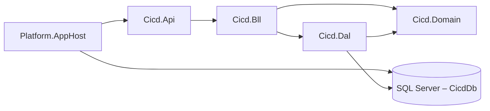
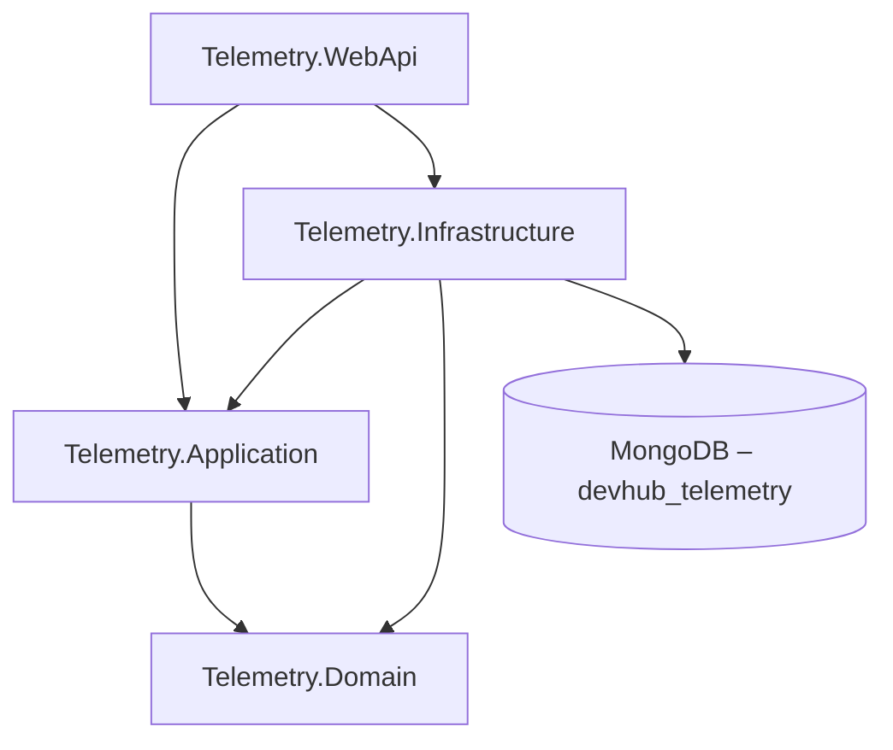

# DevHub

DevHub – внутрішня платформа розробників однієї організації. Команди публікують бібліотеки як
версійовані пакети, CI-конвеєри збирають їх після кожного коміту, а мейнтейнери стежать за
аваріями й обговорюють дефекти пакетів зі споживачами.

Система складається з трьох незалежних контекстів, кожен з яких має власну базу даних; повний опис
контекстів, сутностей і агрегатів наведено в [docs/contexts.md](docs/contexts.md).

| № | Контекст | БД | Технологія | Сутності / колекції |
| --- | --- | --- | --- | --- |
| 1 | Збірки CI/CD | `DevHub_Cicd` | SQL Server + ADO.NET і Dapper | `Pipeline`, `Agent`, `BuildRun`, `BuildRunDetail`, `BuildStep`, `Artifact`, `ArtifactUsage`, `RunStatusHistory` |
| 2 | Реєстр пакетів | `DevHub_Registry` | SQL Server + EF Core (Code First) | `Publisher`, `Package`, `PackageVersion`, `PackageManifest`, `Tag`, `PackageTag` |
| 3 | Телеметрія й обговорення | `devhub_telemetry` | MongoDB | `buildEvents`, `crashReports`, `discussions`, `packageInsights` |

Спільних таблиць між базами немає, як і жодного FOREIGN KEY. Посилання на сутність іншого
контексту – звичайний стовпець або поле з її Id без зовнішнього ключа:

| Де | Поле з Id | На що посилається |
| --- | --- | --- |
| `cicd.Pipeline`, `cicd.Artifact` | `PackageId` | `registry.Package.PackageId` |
| `crashReports` | `packageVersionId`, `packageId` | `registry.PackageVersion`, `registry.Package` |
| `discussions`, `packageInsights` | `packageId` | `registry.Package.PackageId` |
| `buildEvents` | `buildRunId`, `packageId` | `cicd.BuildRun.BuildRunId`, `registry.Package.PackageId` |
| `discussions` | `linkedBuildRunIds[]` | `cicd.BuildRun.BuildRunId` |

Поруч з Id зберігається його читабельна форма: `packageKey` = `"<publisher>/<package>"`,
`versionKey` = `"<publisher>/<package>@<semver>"`, `runKey` = `"<pipeline>#<run number>"`. Це
дубльовані поля, тож кожне з них є в таблиці нижче.

## Політика дублювання

| Поле | Де зберігається | Джерело (власник даних) | Політика узгодженості |
| --- | --- | --- | --- |
| `cicd.Pipeline.PackageKey` | БД збірок (`DevHub_Cicd`) | `registry.Publisher.Slug` + `registry.Package.Name` (Реєстр) | оновлюється подіями з Реєстру |
| `cicd.Artifact.PackageName` | БД збірок (`DevHub_Cicd`) | `registry.Package.Name` (Реєстр) | знімок на момент збірки, не оновлюється |
| `cicd.Artifact.PublisherSlug` | БД збірок (`DevHub_Cicd`) | `registry.Publisher.Slug` (Реєстр) | знімок на момент збірки, не оновлюється |
| `cicd.Artifact.PackageKey` | БД збірок (`DevHub_Cicd`) | `registry.Publisher.Slug` + `registry.Package.Name` (Реєстр) | знімок на момент збірки, не оновлюється |
| `cicd.Artifact.SemVer` | БД збірок (`DevHub_Cicd`) | `registry.PackageVersion.SemVer` (Реєстр) | знімок; опублікована версія незмінна |
| `discussions.packageName`, `discussions.publisherSlug`, `discussions.packageKey` | БД телеметрії (`devhub_telemetry`) | `registry.Package.Name`, `registry.Publisher.Slug` (Реєстр) | оновлюється подіями з Реєстру |
| `packageInsights.packageName`, `packageInsights.publisherSlug`, `packageInsights.packageKey` | БД телеметрії (`devhub_telemetry`) | `registry.Package.Name`, `registry.Publisher.Slug` (Реєстр) | оновлюється подіями з Реєстру |
| `crashReports.packageKey`, `crashReports.versionKey` | БД телеметрії (`devhub_telemetry`) | `registry.Publisher.Slug` + `registry.Package.Name` + `registry.PackageVersion.SemVer` (Реєстр) | знімок на момент аварії; версія незмінна |
| `buildEvents.packageKey` | БД телеметрії (`devhub_telemetry`) | `registry.Publisher.Slug` + `registry.Package.Name` (Реєстр) | знімок на момент події, не оновлюється |
| `buildEvents.pipelineName`, `buildEvents.runNumber`, `buildEvents.runKey` | БД телеметрії (`devhub_telemetry`) | `cicd.Pipeline.Name`, `cicd.BuildRun.RunNumber` (Збірки CI/CD) | знімок на момент події, не оновлюється |

Кожне дубльоване поле має одного власника, а копії тільки читають і ніколи не пишуть назад.
Поля-знімки й поля-посилання БД збірок задокументовано описами `MS_Description` поруч із
колонками (`db/p1/schema.sql`), у MongoDB для цього слугує властивість `description` у JSON Schema
(`db/p3/collections.js`).

## Ключі та конкурентність

Первинні ключі мають тип `BIGINT IDENTITY`. Ключі генерує одне джерело, сама база, тому
послідовна вставка не фрагментує кластерний індекс, а глобально унікальний GUID не потрібен:
інші контексти посилаються на рядок за його Id і нових ключів не створюють.

Таблиці, які можуть змінювати паралельно, мають колонку `RowVersion ROWVERSION` для оптимістичної
конкурентності. Процедури `cicd.usp_TransitionRunStatus` і `cicd.usp_DeleteBuildRun` відхиляють
зміну із застарілою версією рядка (помилки 50021 і 50051).

Для аудиту й м’якого видалення кожна бізнес-таблиця має `CreatedAt`, `CreatedBy`, `UpdatedAt`,
`UpdatedBy` та `IsDeleted`.

## ERD

Проєкт №1, `DevHub_Cicd`:


Проєкт №2, `DevHub_Registry`:


Проєкт №3: приклади документів кожної колекції в [docs/examples/](docs/examples).

## Розгортання

Потрібні SQL Server (наприклад, `(localdb)\MSSQLLocalDB`) із `sqlcmd` і Docker для MongoDB.
Усі скрипти ідемпотентні: перед кожною вставкою вони перевіряють, що запису ще немає, тож
повторний запуск не створює дублікатів і не видаляє даних.

### Проєкт №1 – `DevHub_Cicd`

```bash
sqlcmd -S "(localdb)\MSSQLLocalDB" -b -i db/p1/schema.sql
sqlcmd -S "(localdb)\MSSQLLocalDB" -b -i db/p1/procedures.sql
sqlcmd -S "(localdb)\MSSQLLocalDB" -b -i db/p1/seed.sql
sqlcmd -S "(localdb)\MSSQLLocalDB" -b -i db/p1/security.sql -v CicdAppPassword="Repetovskyi#Cicd26"
sqlcmd -S "(localdb)\MSSQLLocalDB" -b -i db/p1/verify.sql
```

`schema.sql` створює базу, таблиці, індекси й представлення; `procedures.sql` – шість
збережуваних процедур; `seed.sql` – тестові дані; `security.sql` – окремий логін застосунку
`devhub_cicd_app` з доступом лише до `DevHub_Cicd` і схеми `cicd`, а також роль читача без права
запису; `verify.sql` перевіряє ключі, обмеження, індекси, процедури й доступи та завершується
помилкою, якщо не пройшла хоч одна перевірка. Пароль логіна передають під час розгортання
через `-v`. Пароль у команді навчальний і призначений для локальної бази, але відповідає політиці
паролів Windows, тож SQL Server приймає його без змін.

Запуск процедур:

```sql
DECLARE @PipelineId BIGINT = (SELECT PipelineId FROM cicd.Pipeline WHERE Name = N'devhub-auth CI');
DECLARE @RunId BIGINT, @AgentId BIGINT;
EXEC cicd.usp_QueueBuildRun @PipelineId = @PipelineId, @CommitSha = '9e8d7c6b5a4f3e2d1c0b9a8f7e6d5c4b3a2f1e0d',
     @CommitMessage = N'Fix', @BranchName = N'main', @TriggeredBy = N'dev', @TriggerKind = 'Manual',
     @BuildRunId = @RunId OUTPUT;
EXEC cicd.usp_LeaseAgent @BuildRunId = @RunId, @OperatingSystem = N'Windows', @LeasedBy = N'dev', @AgentId = @AgentId OUTPUT;
EXEC cicd.usp_TransitionRunStatus @BuildRunId = @RunId, @ToStatus = 'Succeeded', @ChangedBy = N'dev';
EXEC cicd.usp_GetRunTimeline @BuildRunId = @RunId;
```

| Процедура | Операція |
| --- | --- |
| `usp_QueueBuildRun` | створення запуску, деталей і першого запису історії в одній транзакції |
| `usp_GetRunTimeline` | читання запуску з кроками, історією статусів і артефактами |
| `usp_TransitionRunStatus` | зміна статусу в явній транзакції; недопустимий перехід – помилка 50022 |
| `usp_DeleteBuildRun` | м’яке видалення завершеного запуску |
| `usp_LeaseAgent` | захоплення вільного агента і старт запуску |
| `usp_CompleteBuildRun` | завершення запуску: кроки, артефакти, історія й звільнення агента атомарно |

### Проєкт №2 – `DevHub_Registry`

```bash
sqlcmd -S "(localdb)\MSSQLLocalDB" -b -i db/p2/schema.sql
sqlcmd -S "(localdb)\MSSQLLocalDB" -b -i db/p2/seed.sql
sqlcmd -S "(localdb)\MSSQLLocalDB" -b -i db/p2/security.sql -v RegistryAppPassword="Kostenuk#Registry26"
sqlcmd -S "(localdb)\MSSQLLocalDB" -b -i db/p2/verify.sql
```

`security.sql` створює окремий логін застосунку `devhub_registry_app` з доступом лише до
`DevHub_Registry` і роль читача без права запису.

Схема готова до міграцій. Кожне обмеження й індекс має явне ім’я (`PK_`, `FK_`, `UQ_`, `CK_`,
`DF_`, `IX_`), тож наступна міграція змінює чи видаляє його за іменем однаково в будь-якому
середовищі, а `schema.sql` створює лише відсутні об’єкти. Далі структурою цієї бази керують
міграції EF Core Code First.

### Проєкт №3 – `devhub_telemetry`

```bash
docker run -d --name devhub-mongo -p 27017:27017 mongo:8
docker cp db/p3 devhub-mongo:/p3
docker exec devhub-mongo mongosh devhub_telemetry --quiet /p3/collections.js
docker exec devhub-mongo mongosh devhub_telemetry --quiet /p3/seed.js
docker exec devhub-mongo mongosh devhub_telemetry --quiet /p3/verify.js
```

`collections.js` створює колекції з валідацією JSON Schema та індекси. `seed.js` додає документи
й перед вставкою перевіряє наявність кожного за природним ключем. `verify.js` перевіряє
структуру, валідацію, індекси та запити.

### Перевірка індексів і обмежень вручну

```sql
SELECT t.name AS TableName, i.name AS IndexName, ep.value AS ServesQuery
FROM sys.indexes AS i
JOIN sys.tables AS t ON t.object_id = i.object_id
LEFT JOIN sys.extended_properties AS ep ON ep.major_id = i.object_id AND ep.minor_id = i.index_id AND ep.class = 7
WHERE i.name LIKE 'IX[_]%';

SELECT * FROM sys.foreign_keys;
```

## Сервіс збірок CI/CD

Проєкт №1 реалізовано як окремий мікросервіс із трьома шарами. Залежності спрямовані в один бік:
контролери звертаються лише до сервісів, сервіси – до Unit of Work і репозиторіїв, а моделі та
доменні винятки лежать у `Cicd.Domain`, який бачать і DAL, і BLL. Це означає, що жоден SQL-запит
не виходить за межі DAL. Контролери рішень не приймають.

### Схема рішення



| Проєкт | Вміст |
| --- | --- |
| `Cicd.Api` | контролери, глобальний обробник помилок у форматі ProblemDetails, `Program.cs`, `appsettings.json` |
| `Cicd.Bll` | DTO, профілі AutoMapper, сервіси й бізнес-правила |
| `Cicd.Dal` | `IGenericRepository<T>`, `BaseDapperRepository<T>`, репозиторії на Dapper і на чистому ADO.NET, Unit of Work |
| `Cicd.Domain` | моделі таблиць схеми `cicd` і доменні винятки |
| `Cicd.Tests` | інтеграційні тести DAL і BLL, перевірка конфігурації AutoMapper |
| `Platform.AppHost` | запуск API разом з усією платформою в .NET Aspire |

### Що потрібно для запуску

Потрібні .NET SDK 9.0.318 (версію зафіксовано в `global.json`) і Docker Desktop; Visual Studio 2022
17.14 відкриває `Platform.slnx`, але для запуску достатньо командного рядка. Перший запуск
завантажує образ SQL Server 2022, це близько 2,3 ГБ, тому він триває кілька хвилин; наступні
стартують приблизно за пів хвилини.

API й Aspire Dashboard працюють через HTTPS із сертифікатом розробника .NET. Один раз на машині
його треба зробити довіреним, інакше `curl` і браузер відхилять з’єднання:

```bash
dotnet dev-certs https --trust
```

Ключ ліцензії AutoMapper (безкоштовна редакція Community з automapper.io) зберігається в user
secrets проєкту `Cicd.Api`, а не в репозиторії. Без ключа сервіс працює так само, AutoMapper лише
записує в лог попередження про відсутню ліцензію.

```bash
dotnet user-secrets set "AutoMapper:LicenseKey" "<ключ з automapper.io>" --project Services/Cicd/Cicd.Api
```

### Запуск через Aspire

Сервіс стартує разом з усією платформою, кроки наведено в розділі «Запуск платформи». AppHost
створює контейнер SQL Server, у ньому базу `DevHub_Cicd` як ресурс `CicdDb` і заповнює її скриптами
`db/p1/schema.sql`, `procedures.sql` та `seed.sql`; API стартує лише тоді, коли база готова. Через
Gateway сервіс доступний на `http://localhost:5000`, напряму – на `https://localhost:7178`, опис
усіх ендпоінтів – на `https://localhost:7178/swagger`.

Перелік ендпоінтів API у Swagger:


Рядок підключення `ConnectionStrings:CicdDb` API читає з `appsettings.json`; за замовчуванням він
вказує на базу в LocalDB, розгорнуту за розділом «Розгортання». Aspire передає API рядок підключення до контейнера
через змінну оточення `ConnectionStrings__CicdDb`, яка має пріоритет над файлом; так само можна
вказати будь-яку іншу базу без зміни коду. Без Aspire API запускається командою
`dotnet run --project Services/Cicd/Cicd.Api` і працює з LocalDB.

### Транзакції, рівень ізоляції й таймаути

Unit of Work відкриває одне з’єднання на HTTP-запит, і всі репозиторії працюють через нього та
через одну поточну транзакцію. Найважливіша операція – завершення запуску
(`POST /api/build-runs/{id}/complete`), що в одній транзакції переводить запуск у `Succeeded`
процедурою `usp_TransitionRunStatus`, додає артефакти, зв’язує їх із запуском і копіює з конвеєра
Id, ключ та назву пакета як знімок за політикою дублювання, тож артефакт не залежить від того, що
згодом станеться з пакетом у Реєстрі. Збій будь-якого кроку відкочує транзакцію повністю. Статус
запуску тоді лишається `Running`.

Рівень ізоляції – `READ COMMITTED`. Процедури самі блокують рядок, який змінюють
(`UPDLOCK, HOLDLOCK`), тому `REPEATABLE READ` чи `SERIALIZABLE` лише довше тримали б зайві
блокування й підвищували ризик взаємних блокувань, а узгодженості не додали б. Паралельні зміни
того самого запуску ловить `RowVersion`. Застаріла версія рядка дає 409. Таймаут команди – 30 с
(`RepositoryBase.CommandTimeoutSeconds`), таймаут з’єднання – стандартні 15 с SqlClient.

### Помилки

Усі помилки повертаються у форматі ProblemDetails з полем `traceId`; перетворення робить один
глобальний обробник `DomainExceptionHandler`.

| Ситуація | Статус |
| --- | --- |
| `NotFoundException` – запису немає | 404 |
| `BusinessConflictException` – недопустимий перехід статусу, дублікат, вимкнений конвеєр | 409 |
| `ValidationException` і порушені атрибути DataAnnotations на DTO | 400 |
| будь-яка інша помилка | 500 |

### Приклади запитів (curl)

У свіжому контейнері `seed.sql` створює чотири запуски, тому перший новий запуск отримує Id 5.

```bash
API=https://localhost:7178

curl -i $API/api/pipelines

curl -i -X POST $API/api/build-runs -H "Content-Type: application/json" \
  -d '{"pipelineId":1,"commitSha":"a1b2c3d4e5f60718293a4b5c6d7e8f9012345678","commitMessage":"Fix token refresh","branchName":"main","triggeredBy":"o.kovalenko","triggerKind":"Manual"}'

curl -i -X POST $API/api/build-runs/5/start -H "Content-Type: application/json" \
  -d '{"operatingSystem":"Windows","leasedBy":"o.kovalenko"}'

curl -i -X POST $API/api/build-runs/5/complete -H "Content-Type: application/json" \
  -d '{"completedBy":"o.kovalenko","artifacts":[{"semVer":"2.2.0","sizeBytes":1130496,"sha256":"5f1e2d3c4b5a69788796a5b4c3d2e1f00f1e2d3c4b5a69788796a5b4c3d2e1f0","storageUri":"https://artifacts.devhub.local/auth/2.2.0.nupkg"}]}'

curl -i $API/api/build-runs/5/timeline

curl -i -X POST $API/api/build-runs/5/complete -H "Content-Type: application/json" \
  -d '{"completedBy":"o.kovalenko","artifacts":[{"semVer":"2.2.1","sizeBytes":1,"sha256":"6e2f3d4c5b6a79808a97b6c5d4e3f2011f2e3d4c5b6a79808a97b6c5d4e3f201","storageUri":"https://artifacts.devhub.local/auth/2.2.1.nupkg"}]}'

curl -i $API/api/build-runs/999999

curl -i "$API/api/agents?status=Idle"
```

Перший `POST` повертає 201 із заголовком `Location`, `start` захоплює вільного агента, перше
`complete` – 200 із хронологією запуску та новим артефактом. Повторне `complete` того самого
запуску дає 409. Запит на Id, якого немає, дає 404, а не 500.

## Сервіс реєстру пакетів

Проєкт №2 реалізовано як другий мікросервіс із тими самими трьома шарами, але доступ до даних
побудовано на Entity Framework Core. Схему бази описують сутності з `Registry.Domain` і конфігурації
Fluent API з `Registry.Dal/Configurations`, по одному класу на сутність; базу створює міграція.
Назви таблиць, ключів, обмежень та індексів у міграції ті самі, що й у `db/p2/schema.sql`.

| Проєкт | Вміст |
| --- | --- |
| `Registry.Api` | контролери, глобальний обробник помилок, `Program.cs`, `appsettings.json`, `Dockerfile` |
| `Registry.Bll` | DTO, профілі AutoMapper, валідатори FluentValidation, специфікації, сервіси |
| `Registry.Dal` | `RegistryDbContext`, конфігурації, міграції, репозиторії, Unit of Work, початкові дані |
| `Registry.Domain` | сутності й доменні винятки |

Таблиця `Package` отримала стовпець `LicensePrice` типу `decimal(18,2)` – ціну одного місця
комерційної ліцензії. Нуль означає безкоштовний пакет. Стовпець додано і в `db/p2/schema.sql`.

### Запуск і застосування міграцій

Потрібні .NET SDK 9.0.318, SQL Server LocalDB та інструмент `dotnet-ef`
(`dotnet tool install --global dotnet-ef`).

1. Переконайтеся, що бази `DevHub_Registry` на сервері ще немає. Якщо її вже створено скриптами з
   розділу «Розгортання», видаліть її або вкажіть іншу назву бази у змінній оточення
   `ConnectionStrings__RegistryDb`: міграція створює таблиці з нуля й на готовій схемі зупиниться
   з помилкою.
2. Застосуйте міграції:

   ```bash
   dotnet ef database update --project Services/Registry/Registry.Dal --startup-project Services/Registry/Registry.Api
   ```

3. Запустіть API:

   ```bash
   dotnet run --project Services/Registry/Registry.Api --launch-profile https
   ```

4. Відкрийте `https://localhost:7179/swagger`.

Крок 2 можна пропустити: під час старту API сам викликає `MigrateAsync()` і застосовує міграції,
яких бракує. SQL-скрипт початкової міграції, згенерований командою `dotnet ef migrations script`,
лежить у `Services/Registry/Registry.Dal/Migrations/InitialCreate.sql`. Нову міграцію додає команда:

```bash
dotnet ef migrations add <Назва> --project Services/Registry/Registry.Dal --startup-project Services/Registry/Registry.Api
```

### Початкові дані

Довідники – три видавці й п’ять тегів – мають фіксовані Id і записані в міграцію через `HasData`.
Пакети, версії, маніфести та зв’язки з тегами додає `DbInitializer` після міграцій, якщо таблиця
пакетів порожня, тому повторний запуск нічого не дублює. У середовищі Production `DbInitializer`
не викликається. Перші чотири пакети отримують ті самі Id, що й у `db/p2/seed.sql`, бо на них
посилаються інші контексти.

### Пагінація, фільтрація й сортування

`GET /api/packages` приймає параметри `page` (з 1), `pageSize` (типово 20, не більше 100), `search`,
`publisherId`, `minPrice`, `maxPrice`, `sortBy` (`name`, `price` або `downloads`) і `sortDir`
(`asc` або `desc`). Метадані сторінки повертаються в тілі відповіді поруч з елементами: `items`,
`totalCount`, `page`, `pageSize`, `totalPages`, `hasNext`, `hasPrevious`. Фільтр, сортування, `Skip`
і `Take` описує специфікація `PackagesFilterSpec`, репозиторій застосовує її до `DbSet`, тож база
повертає лише одну сторінку. Значення `totalCount` рахує окремий запит `COUNT` із тим самим
фільтром.

```bash
API=https://localhost:7179

curl -i "$API/api/packages?page=2&pageSize=5&sortBy=price&sortDir=desc"

curl -i "$API/api/packages?search=devhub&minPrice=0&maxPrice=50"

curl -i $API/api/packages/2

curl -i -X POST $API/api/packages -H "Content-Type: application/json" \
  -d '{"publisherId":1,"name":"devhub-cache","description":"Two-level cache helpers.","licensePrice":15.50}'

curl -i -X POST $API/api/packages -H "Content-Type: application/json" \
  -d '{"publisherId":1,"name":"devhub-cache","licensePrice":0}'

curl -i $API/api/packages/999999

curl -i "$API/api/tags/infrastructure/recent-packages?since=2026-08-01"
```

Перший `POST` повертає 201 із заголовком `Location`, другий із тією самою назвою – 409. Запит на Id,
якого немає, дає 404 у форматі ProblemDetails.

### Валідація й помилки

Прості правила (обов’язковість, довжина, діапазон) задано атрибутами DataAnnotations на DTO,
складніші – валідаторами FluentValidation: дозволені символи назви, адреса лише з `https://`, ціна
з двома знаками після коми, список полів сортування. Валідатори зареєстровано через
`AddValidatorsFromAssembly`, контролер викликає їх явно й повертає `ValidationProblemDetails`. Решту
помилок перетворює один обробник `GlobalExceptionHandler`. Поле `detail` заповнюється лише в
середовищі Development.

| Ситуація | Статус |
| --- | --- |
| `EntityNotFoundException` – пакета, тега чи видавця немає | 404 |
| `ValidationException`, порушені атрибути або правила валідатора | 400 |
| `ConflictException` – пакет із такою назвою у видавця вже є, тег уже призначено | 409 |
| `DomainException` – порушено правило сутності, наприклад завантаження прихованого пакета | 409 |
| будь-яка інша помилка | 500 |

### Логування

Serilog налаштовано один раз у `Platform.ServiceDefaults` (розділ «Логування й трасування»), тому
сервіс пише ті самі структуровані записи, що й решта платформи, з `CorrelationId` запиту. Секція
`Serilog` в `appsettings.Development.json` лишає для категорії
`Microsoft.EntityFrameworkCore.Database.Command` рівень Information, тож у лозі видно кожен
SQL-запит EF Core. Виняток записується один раз, в обробнику помилок. Рівень можна змінити без
правки файла змінною оточення, наприклад
`Serilog__MinimumLevel__Override__Microsoft.EntityFrameworkCore.Database.Command=Warning`.

Запит `GET /api/packages/2` завантажує пакет разом із видавцем, версіями, маніфестами й тегами через
`Include` – це один SQL-запит. Запит `GET /api/tags/3` спершу читає тег, а пакети довантажує окремо
через `Entry(...).Collection(...).LoadAsync()` – це два запити. У вкладці Structured logs фільтр за
`CorrelationId` першого запиту показує один запис `Executed DbCommand`, другого – два.

### Знімки екрана

Перелік ендпоінтів API у Swagger:


Відповідь із пагінацією на запит `page=2&pageSize=5`:


Відповідь 400 з помилками валідації по полях:


## Сервіс телеметрії та обговорень

Проєкт №3 побудовано за Clean Architecture з чотирьох шарів, і залежності в ньому спрямовані
всередину. `Telemetry.Domain` не посилається на жоден проєкт, а з пакетів має лише `MongoDB.Bson`
заради типу `ObjectId`; драйвера MongoDB у домені немає. `Telemetry.Application` знає тільки домен.
`Telemetry.Infrastructure` реалізує інтерфейси, оголошені в домені й в Application. `Telemetry.WebApi`
посилається на Application та Infrastructure, причому Infrastructure потрібен йому лише для
реєстрації залежностей під час старту. Кожна операція API – окрема команда або запит MediatR, і
кожен проходить через ланцюжок behaviors: логування, валідацію FluentValidation, вимірювання часу.

### Схема шарів



| Проєкт | Вміст |
| --- | --- |
| `Telemetry.Domain` | `BaseEntity`, `ValueObject`, сутності `Discussion`, `Comment`, `CrashReport`, value objects `ExceptionInfo`, `StackFrame`, `PerformanceMetric`, доменні винятки, інтерфейси репозиторіїв |
| `Telemetry.Application` | команди й запити з обробниками та валідаторами, behaviors, інтерфейси читання `IDiscussionQueries` і `ICrashReportQueries`, профіль AutoMapper, `DependencyInjection.cs` |
| `Telemetry.Infrastructure` | `MongoDbContext`, мапінг `BsonClassMap`, репозиторії, реалізації інтерфейсів читання, сідінг, створення індексів, `DependencyInjection.cs` |
| `Telemetry.WebApi` | контролери, глобальний обробник помилок, `Program.cs`, `appsettings*.json` |
| `Telemetry.Tests` | модульні тести домену, конвеєра валідації, мапінгу AutoMapper і BSON |

Сервіс працює з колекціями `discussions` і `crashReports`. Документи мають ту саму структуру, що
створюють скрипти `db/p3`: імена полів у camelCase, коментарі з відповідями вкладено в
обговорення, а підсумки винятку, кадри стека й метрику – у звіт про збій. Для оптимістичної
конкурентності валідатори обох колекцій у `db/p3/collections.js` отримали поля `updatedAt` і
`version`. Скрипт дописує `version: 0` документам, де цього поля ще немає. Оновлення записується
лише в документ з очікуваною версією.

### Запуск

Потрібні .NET SDK 9.0.318 і Docker Desktop.

1. Запустіть MongoDB 8 у контейнері (той самий, що в розділі «Розгортання»; якщо контейнер уже
   є, достатньо `docker start devhub-mongo`):

   ```bash
   docker run -d --name devhub-mongo -p 27017:27017 mongo:8
   ```

2. За бажанням розгорніть базу скриптами `db/p3` за розділом «Розгортання», тоді колекції матимуть
   валідатори JSON Schema. Без цього кроку сервіс сам створить колекції, індекси й початкові дані.
3. Збережіть ключ ліцензії Lucky Penny у user secrets. Один ключ покриває і MediatR, і AutoMapper;
   без нього сервіс працює так само, лише пише в лог попередження.

   ```bash
   dotnet user-secrets set "LuckyPenny:LicenseKey" "<ключ>" --project Services/Telemetry/Telemetry.WebApi
   ```

4. Запустіть API:

   ```bash
   dotnet run --project Services/Telemetry/Telemetry.WebApi --launch-profile https
   ```

5. Відкрийте `https://localhost:7180/swagger`.

Під час старту `IndexCreationService` створює складені, унікальний, текстовий і TTL-індекси з тими
самими назвами, що в `db/p3/collections.js`, тож сервіс і скрипт можна застосовувати до однієї бази.
Після нього кожен `IDataSeeder` перевіряє, чи порожня його колекція, і лише тоді одним
`InsertManyAsync` додає документи з `Telemetry.Infrastructure/Seeding/Data`. Повторний запуск
нічого не дублює. У середовищі Production сідінг не виконується.

Рядок підключення й назву бази задає секція `MongoDb` в `appsettings.json`; для Development, Staging
і Production є окремі файли `appsettings.{Environment}.json`. Розмір пулу з’єднань і таймаут вибору
сервера записано в самому рядку (`maxPoolSize`, `serverSelectionTimeoutMS`). Змінна оточення
`MongoDb__ConnectionString` має пріоритет над файлом. Під AppHost рядок підключення приходить як
`ConnectionStrings:TelemetryDb` і замінює значення із секції `MongoDb`. Стан підключення до MongoDB
повертає `GET /health`.

### Приклади запитів (curl)

```bash
API=https://localhost:7180

curl -i "$API/api/discussions?state=open&page=1&pageSize=5"

curl -i -X POST $API/api/discussions -H "Content-Type: application/json" \
  -d '{"packageId":5,"packageKey":"platform-team/devhub-logging","packageName":"devhub-logging","publisherSlug":"platform-team","title":"Structured scopes are dropped by the console sink","category":"bug","openedBy":"o.kovalenko"}'

curl -i -X POST $API/api/discussions -H "Content-Type: application/json" \
  -d '{"packageId":0,"packageKey":"platform-team/devhub-logging","packageName":"devhub-logging","publisherSlug":"platform-team","title":"Structured scopes are dropped by the console sink","category":"bug","openedBy":"o.kovalenko"}'

curl -i -X PUT $API/api/discussions/<id> -H "Content-Type: application/json" \
  -d '{"title":"Structured scopes are dropped by the console sink","category":"bug","labels":["sink"],"version":0}'

curl -i "$API/api/crash-reports?severity=high"
```

Перший `POST` повертає 201 і заголовок `Location` з ObjectId у вигляді рядка. Якщо повторити його,
асинхронне правило валідатора знайде таку саму назву в пакета й поверне 400. Запит із
`packageId: 0` відхиляється ще до обробника: у лозі є рядок `Handling CreateDiscussionCommand` і
попередження про `ValidationException`, а рядка `Handled` немає. Перший `PUT` з `version: 0` повертає
обговорення з версією 1, той самий `PUT` удруге дає 409.

| Ситуація | Статус |
| --- | --- |
| `NotFoundException` – документа немає | 404 |
| `ValidationException` FluentValidation, зокрема некоректний ObjectId | 400 |
| `DomainException` – порушено правило сутності, наприклад коментар у закритому обговоренні | 400 |
| `ConflictException` – документ уже змінено, версія застаріла | 409 |
| `MongoWriteException` з DuplicateKey – порушено унікальний індекс | 409 |
| інша помилка запису MongoDB, наприклад відмова валідатора колекції | 400 |
| `MongoConnectionException` або таймаут вибору сервера | 503 |
| будь-яка інша помилка | 500 |

### Знімки екрана

Перелік ендпоінтів API у Swagger:


Документ `discussions` у MongoDB Compass, записаний сідінгом сервісу: поля в camelCase, вкладені
коментарі з відповідями й реакціями, поле `version`, без службових полів .NET:


Результат `db.discussions.getIndexes()` у вбудованій оболонці Compass:


## Платформа на .NET Aspire

Три сервіси працюють як одна платформа, яку запускає одна команда. `Platform.AppHost` піднімає
контейнери баз даних, сервіси, агрегатор і шлюз у правильному порядку. Клієнт звертається лише до
`Platform.ApiGateway` на порту 5000, а сервіси знаходять один одного за іменами ресурсів AppHost
(`cicd-api`, `registry-api`, `telemetry-api`, `aggregator`) замість `localhost` і порту.

### Схема рішення

```mermaid
flowchart LR
    Client[Клієнт] --> Gateway[Platform.ApiGateway :5000]
    Gateway --> Cicd[cicd-api]
    Gateway --> Registry[registry-api]
    Gateway --> Telemetry[telemetry-api]
    Gateway --> Aggregator[aggregator]
    Aggregator -. Task.WhenAll .-> Cicd
    Aggregator -. Task.WhenAll .-> Registry
    Aggregator -. Task.WhenAll .-> Telemetry
    Cicd --> CicdDb[(SQL Server – CicdDb)]
    Registry --> RegistryDb[(SQL Server – RegistryDb)]
    Telemetry --> TelemetryDb[(MongoDB – TelemetryDb)]
```

| Проєкт | Вміст |
| --- | --- |
| `Platform.AppHost` | `AppHost.cs`: контейнери SQL Server і MongoDB з томами даних, реєстрація сервісів, агрегатора й шлюзу з `WithReference` і `WaitFor` |
| `Platform.ServiceDefaults` | `Extensions.cs` (Serilog, OpenTelemetry, health checks, service discovery, стійкість HttpClient), `CorrelationIdMiddleware`, `CorrelationIdHandler` |
| `Platform.ApiGateway` | маршрути YARP, логування маршрутизації, `Dockerfile` |
| `Platform.Aggregator` | типізовані HTTP-клієнти трьох сервісів, політики стійкості, картка запуску збірки, обробка часткових відмов |

Кожен сервіс посилається лише на `Platform.ServiceDefaults`, а AppHost – на всі сервіси, шлюз і
агрегатор. На AppHost не посилається ніхто. У коді сервісів змінено тільки `Program.cs`: він на
початку викликає `AddServiceDefaults()`, після `Build()` підключає `CorrelationIdMiddleware`, а
наприкінці `MapDefaultEndpoints()`; власне налаштування Serilog із сервісів прибрано. Поза
`Program.cs` лежать ще дві зміни: власні spans бізнес-операцій (розділ «Логування й трасування») і
підписка драйвера MongoDB на трасування в `MongoDbContext`.

### Запуск платформи

Потрібні .NET SDK 9.0.318 і Docker Desktop.

1. Запустіть Docker Desktop.
2. Один раз зробіть довіреним сертифікат розробника: `dotnet dev-certs https --trust`.
3. Збережіть пароль SQL Server у user secrets AppHost. Пароль – параметр-секрет `sql-password`, у коді
   його немає. Нижче локальний навчальний пароль:

   ```bash
   dotnet user-secrets set "Parameters:sql-password" "Repetovskyi#Sql26" --project Platform.AppHost
   ```

4. За потреби збережіть ключі ліцензій AutoMapper і Lucky Penny (розділи сервісів вище).
5. З кореня репозиторію запустіть AppHost:

   ```bash
   dotnet run --project Platform.AppHost
   ```

6. Відкрийте Aspire Dashboard за посиланням із консолі й дочекайтеся статусу Running для всіх
   одинадцяти ресурсів.
7. Надсилайте запити на Gateway: `http://localhost:5000`.

Перший запуск завантажує образи SQL Server 2022 і MongoDB 8. Дані лежать у томах Docker, тому
після перезапуску бази лишаються. Том SQL Server запам’ятовує пароль першого запуску; щоб змінити
пароль, видаліть том `platform.apphost-…-sql-data`. Порядок старту задають ланцюжки `WaitFor`:
бази даних, потім сервіси, агрегатор і наостанок Gateway. Сервіси отримують рядки підключення
`ConnectionStrings__CicdDb`, `ConnectionStrings__RegistryDb` і `ConnectionStrings__TelemetryDb`;
імена збігаються з тими, що сервіси читали й раніше, а резервні рядки в `appsettings.json` лишилися
для запуску без Aspire.


### Маршрути Gateway

Маршрути YARP лежать у секції `ReverseProxy` файла `Platform.ApiGateway/appsettings.json`. Кожен
префікс API має маршрут виду `/api/pipelines/{**catch-all}`, а кластер сервісу вказує на адресу
`http://<ім’я ресурсу>`, яку підставляє service discovery Aspire. Маршрут агрегатора має `Order: 1`.

| Префікс | Кластер | Ресурс |
| --- | --- | --- |
| `/api/aggregator` | `aggregator` | `aggregator` |
| `/api/pipelines`, `/api/build-runs`, `/api/agents` | `cicd` | `cicd-api` |
| `/api/packages`, `/api/tags` | `registry` | `registry-api` |
| `/api/discussions`, `/api/crash-reports` | `telemetry` | `telemetry-api` |

`CorrelationIdMiddleware` стоїть перед `MapReverseProxy`. Якщо клієнт не надіслав заголовок
`X-Correlation-Id`, Gateway генерує GUID і записує факт генерації в лог. Ідентифікатор потрапляє в
проксований запит і повертається в заголовку відповіді. Після кожного запиту Gateway логує метод,
шлях, IP клієнта, маршрут, кластер, адресу сервісу, статус і тривалість; помилку недоступного
сервісу пише окремим попередженням.

### Приклади запитів через Gateway (curl)

```bash
GW=http://localhost:5000

curl -i $GW/api/pipelines

curl -i "$GW/api/packages?page=1&pageSize=5"

curl -i "$GW/api/discussions?packageKey=platform-team/devhub-auth"

curl -i -X PUT $GW/api/packages/4/license-price -H "Content-Type: application/json" \
  -d '{"licensePrice":12.50}'

curl -i -H "X-Correlation-Id: repetovskyi-card-run1" $GW/api/aggregator/build-runs/1/full

curl -i $GW/api/aggregator/build-runs/999/full
```

Кожна відповідь має заголовок `X-Correlation-Id`; ідентифікатор, який надіслав клієнт, Gateway не
змінює. `PUT` повертає 204. Картка запуску 1 повертає 200, картка запуску, якого немає, – 404.

### Aggregator

`GET /api/aggregator/build-runs/{id}/full` повертає картку запуску збірки. Спершу агрегатор читає
хронологію запуску з `cicd-api`, бо без неї складати нічого. Далі для кожного пакета, який запуск
зібрав, паралельно через `Task.WhenAll` запитує дані пакета з `registry-api`, а обговорення й звіти
про збої – з `telemetry-api`. Кожен виклик пише в лог свою тривалість, а `CancellationToken` доходить
до всіх викликів. До картки потрапляють лише пакети з артефактів цього запуску та обговорення саме цих
пакетів.

Клієнти `CicdClient`, `RegistryClient` і `TelemetryClient` зареєстровано через `AddHttpClient` з
адресами `https+http://cicd-api`, `https+http://registry-api` і `https+http://telemetry-api`.
`CorrelationIdHandler` із `Platform.ServiceDefaults` додає до кожного вихідного запиту той самий
`X-Correlation-Id`.

```json
{
  "run": { "buildRunId": 1, "pipelineName": "devhub-auth CI", "runNumber": 1, "status": "Succeeded", "durationSeconds": 420 },
  "packages": [
    {
      "packageId": 2,
      "packageKey": "platform-team/devhub-auth",
      "builtVersions": ["2.0.0"],
      "licensePrice": 0.00,
      "downloadCount": 48210,
      "discussionCount": 2,
      "discussions": [ { "title": "Document the claim mapping for service accounts", "state": "open" } ],
      "crashReportCount": 1,
      "crashReports": [ { "kind": "unhandledException", "severity": "high" } ]
    }
  ],
  "warnings": []
}
```

JSON іде в camelCase, а поля зі значенням null агрегатор не серіалізує. Якщо `telemetry-api`
недоступний, агрегатор усе одно повертає картку зі статусом 200: дані запуску й пакетів є, полів
обговорень і збоїв немає, а `warnings` містить `"telemetry-api is unavailable"`. Перевірити це можна
так:

1. У Dashboard зупиніть ресурс `telemetry-api` (дія Stop).
2. Повторіть запит картки запуску 1.
3. Запустіть ресурс знову (Start) – наступна відповідь знову повна.

Політики стійкості клієнтів агрегатора задано в його `Program.cs`: спроба обмежена 2 секундами,
повтор один, увесь виклик – 5 секунд. Тому поки сервіс зупинено, картка приходить приблизно за 5
секунд. Недоступність `cicd-api` дає 503, бо без запуску картки не існує.

### Логування й трасування

`AddServiceDefaults()` робить Serilog основним логером для всіх п’яти застосунків. До кожного запису
Serilog додає властивості `ServiceName`, `EnvironmentName`, `MachineName`, `ThreadId` і контекст запиту
(`FromLogContext`); у консоль вони йдуть у форматі `CompactJsonFormatter`. Мінімальний рівень –
Debug у Development та Information в інших середовищах, а шумні категорії ASP.NET Core, EF Core,
HttpClient і Polly підняті до Warning. Параметр `writeToProviders: true` передає записи провайдеру
OpenTelemetry, тому вони з’являються у вкладці Structured logs разом із `TraceId` і `SpanId`.

`CorrelationIdMiddleware` кладе `CorrelationId` у `LogContext` і логує початок та кінець запиту.
Ідентифікатор кореляції створює застосунок, і він описує звернення клієнта; `TraceId` генерує
OpenTelemetry для технічного трасування. Пошук за одним `CorrelationId` у Structured logs знаходить
записи всіх сервісів ланцюжка:


Трасування охоплює вхідні запити ASP.NET Core, вихідні виклики HttpClient, команди SqlClient (і
Dapper, і EF Core працюють через `Microsoft.Data.SqlClient`) та команди MongoDB через
`DiagnosticsActivityEventSubscriber`. Експорт іде через OTLP у Dashboard. У Development
зберігається кожен trace, в інших середовищах частку задає `OpenTelemetry:SamplingRatio`. Власні
spans мають бізнес-операції: `QueueBuildRun` і `CompleteBuildRun` у `BuildRunService`,
`CreatePackage`, `ChangeLicensePrice` і `UnlistPackage` у `PackageService`, `CreateDiscussion` і
`ChangeDiscussionState` в обробниках команд Telemetry. Trace картки запуску показує весь шлях
Gateway → Aggregator → сервіси → бази даних, і виклики `registry-api` та `telemetry-api` в ньому
йдуть паралельно:


